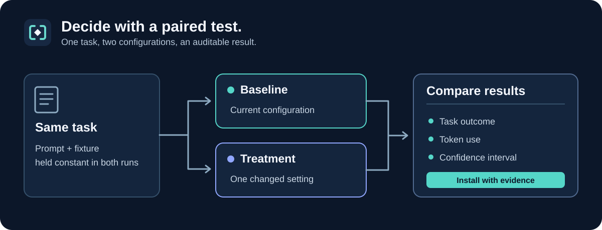

<div align="center">


# skillfit

**Skill registries tell you what's popular. skillfit tells you what actually works.**

Measure whether a skill, rules file, or MCP setup improves *your* agent on *your* tasks —<br/>
then install only what survives the experiment.

[](LICENSE)
[](package.json)
[](https://github.com/remote-controlled-man/skillfit/actions/workflows/ci.yml)
[](package.json)
[](https://github.com/remote-controlled-man/skillfit/stargazers)

[English](README.md) · [简体中文](README.zh-CN.md)

[Quick start](#quick-start) · [Bench guide](benches/README.md) · [Metrics protocol](docs/metrics.md) · [Evidence](evidence/)

</div>

<p align="center">
  
</p>

---

## Why

The agent-config ecosystem has solved **distribution** (`npx skills add`, plugin marketplaces, MCP registries) but not **selection**. The evidence says unverified configuration can hurt:

- Curated skills improve pass rates by **+16.6pp** on average — but agent-self-generated skills score **−1.3pp**, and focused skills beat large bundles ([SkillsBench, arXiv:2602.12670](https://arxiv.org/abs/2602.12670))
- LLM-generated context files scored **−3%** while raising inference cost by 20%+ ([ETH Zurich, arXiv:2602.11988](https://arxiv.org/abs/2602.11988))
- 36% of scanned public skills contain prompt injection ([Snyk ToxicSkills, 2026-02](https://snyk.io/blog/toxicskills-malicious-ai-agent-skills-clawhub/))

skillfit is the missing measurement layer: paired A/B experiments with deterministic verifiers, statistical verdicts, and trigger-rate measurement — packaged as a CLI anyone can run.

Build cases around your own tasks: pin the starting files, write the request, and define what a correct result must do. The bundled benches teach the format; the CLI runs your cases, compares outcomes and costs, and preserves evidence. See the [case authoring guide](docs/bench-authoring.md).

## What you get

A real run, measuring whether an agent even *bothers to load* a skill when it is installed but not mentioned:

```console
$ node dist/cli.js eval ./skills/code-review --mode trigger --bench code-review --agent kimi-code

TASK        FIRE?  FIRED    UNKNOWN  ERRORS  PASS
review-r1   yes    1/3      0        0       3/3
review-r2   yes    0/3      0        0       3/3
review-r3   yes    0/3      0        0       3/3
explain-x1  no     0/3      0        0       3/3

Trigger recall      : 1/9 (11%) [95% CI 2%–44%]
False-trigger rate  : 0/3 (0%) [95% CI 0%–56%]
Precision           : 1/1 (100%) [95% CI 21%–100%]
F1                  : 0.20 (no CI: a harmonic mean of two proportions has no closed-form binomial interval)
```

The skill fired once in nine in-domain tasks — and the tasks pass 3/3 without it. That is a verdict no registry can give you.

<sub>Captured 2026-09-22 on Kimi Code against the four-task `code-review` bench. The bench has since gained a fifth task; the four metric lines above are re-rendered from that run's recorded per-task counts, so the run is real and the formatting is current.</sub>

## Install

```bash
npx skillfit@0.12.0 --help
npx skillfit@0.12.0 doctor
```

`npx skillfit` installs the published release and needs Node.js 22 or newer. You can create and check cases without cloning this repository. npm may download the package first; the case checks and previews below then make no model calls. `skillfit` is the command installed from npm.

## First run with npm

Run these commands in your project directory. Replace `./my-skill` with the directory containing your own `SKILL.md` before previewing:

```bash
npx skillfit@0.12.0 bench init my-bench --kind command --dry-run
npx skillfit@0.12.0 bench init my-bench --kind command --yes
npx skillfit@0.12.0 bench check ./my-bench --json
npx skillfit@0.12.0 eval ./my-skill --bench ./my-bench --mode installed --agent codex --trials 1 --max-calls 2 --runs-root ./runs --run-group first-eval --json --dry-run
```

The scaffold is a teaching case; replace its fixture, prompt, verifier and oracle with your real task before measuring benefit. The preview declares two calls and makes none. Read `plan.evaluation.agentPreflight.status`: generating a plan does not establish a ready CLI or valid login. Keep your bench and runs in separate directories. Continue with [your first real evaluation](docs/first-real-eval.md) for reviewed execution, reports and sharing.

## Run from source

A source checkout lets you build and develop the CLI locally. After `npm run build`, `node dist/cli.js` is that checkout's CLI:

```bash
git clone https://github.com/remote-controlled-man/skillfit.git
cd skillfit
npm ci
npm run build
node dist/cli.js --help
node dist/cli.js bench check benches/code-review
node dist/cli.js bench check benches/debugging
node dist/cli.js doctor
node dist/cli.js eval skills/skillfit --bench code-review --agent codex --dry-run
node dist/cli.js install --agent codex --dry-run
```

The bench checks are offline integrity checks, not agent-quality scores. `doctor` is read-only; the eval and install commands above only print plans. `codex` is an example agent ID; replace it with yours. A real eval needs your own Skill and bench plus a local agent CLI or API credentials. The setup commands below work in Bash and PowerShell; selecting upstream Skills needs network access, and only `--yes` installs them.

`eval` now defaults to **5 trials per condition**. With 8 tasks, a paired experiment makes 80 agent executions. Five trials are a starting point; representative tasks and a healthy baseline matter as much as repetition. Inspect the dry-run count and follow [your first real evaluation](docs/first-real-eval.md) before making an efficacy claim.

For eval and baseline calibration, `--trials` must be an integer from 1 to 20. Fractional, malformed, or out-of-range values are rejected before any run or bench check starts.

Use `--max-calls <n>` for eval or baseline calibration to reject plans above a call ceiling (including enabled judges). New runs retain a frozen plan, call ledger, session state and artifact hashes; input/config drift or executor failures stop further calls. Partial runs cannot support an installation recommendation. Follow the [bounded experiment workflow](docs/experiment-workflow.md), including its environment limits.

Included in 0.10.1: Ctrl+C stops live evaluation processes and subsequent calls, retains available output/usage and seals a stopped run before exit 130. SIGTERM uses exit 143. Partial or unknown usage stays incomplete; interrupted prefixes cannot authorize an upgrade or retry themselves. See [interruption and retained records](docs/evaluation-interruption.md).

Also included in 0.10.1: live `eval` checks selected cases offline before any agent/judge call. Hard failures block execution; warnings and unknown evidence are reported separately and retained with the run. Previews declare these checks pending and execute no verifier/oracle. This adds local checking time and zero model calls. See [case preflight](docs/eval-case-preflight.md).

Supported agents: **Claude Code**, **OpenAI Codex CLI**, **Kimi Code** ([capability matrix](src/matrix/agents.json) — machine-readable, dated, doc-linked). Trigger-mode capture is currently verified for Kimi Code and Codex CLI.

## Build your own cases

Available in 0.10.0: start a code-editing case with a broken fixture, protected tests, independent behavioral checks and a reference repair. The first command previews the files; the second creates a fresh directory; checking and eval preview make no model calls.

```bash
node dist/cli.js bench init my-bench --kind command --dry-run
node dist/cli.js bench init my-bench --kind command --yes
node dist/cli.js bench check my-bench
node dist/cli.js bench check my-bench --json
node dist/cli.js eval skills/skillfit --bench my-bench --agent codex --input workspace --trials 1 --max-calls 2 --dry-run
```

This is a synthetic teaching case, not a Skill benchmark. Replace the fixture, prompt, verifier and oracle with your actual task before measuring benefit. The preview shows two planned calls and starts none. Omit `--kind` (or use `--kind output`) for the existing reply-grading starter. Capture an observed failure with `bench add --freeze`, or import a maintainer fix with `--from-commit`; follow the [authoring guide](docs/bench-authoring.md).

Agent callers can use `bench check --json` for versioned gate identifiers, task IDs, locations, failure reasons, remediation suggestions and bounded verifier evidence. stdout is JSON only; exit codes distinguish passed checks, failed checks and errors. Without `--calibrate`, this remains an offline integrity check; warnings still need review. Version 0.11.0 also supports a separate `--calibrate --json --dry-run` plan, with explicit hash confirmation before JSON execution. See the [JSON contract](docs/bench-check-json.md).

Version 0.11.0 supports quoted verifier/oracle arguments, including script paths with spaces. Recognized grader load/runtime errors and explicit infrastructure-error messages block offline gates or become ungraded evaluation errors, preserving agent costs. Normal task failures and assertions remain graded failures. See [verifier commands and error reporting](docs/verifier-contract.md).

Version 0.12.0 tightens `bench add --freeze`: Git imports never fall back to ignored files, non-Git imports require `--include`, and selected links or destination-bench files are rejected. `--decompose` confirms before its single drafting call and retains costs and failures; see [drafting records](docs/bench-drafting.md). Each case can set `verifierTimeoutSeconds` for verifier/oracle checks, including preflight and replay; the default stays 120 seconds.

The same source checks the Agent environment in eval and baseline-calibration previews and before dispatch: CLI file availability, matrix capability matching and global same-name Skill conflicts. Known failures block before case probes or model calls; login remains explicitly unknown offline. Checks are sealed with the run and read without probing the current machine during report/replay. See [Agent environment preflight](docs/eval-agent-preflight.md).

List and inspect cases, then preview an edit or removal. `--yes` applies a validated manifest change with a backup; removal preserves the case files. Select a smaller paired eval, trigger run or baseline calibration using repeated `--task`, or `taskIds` in a paired JSON request. IDs and order are frozen, budgets count only selected cases, and small samples remain indicative. See [case management](docs/case-management.md).

```bash
node dist/cli.js bench list my-bench --json
node dist/cli.js bench show my-bench example-task --json
node dist/cli.js bench edit my-bench example-task --set shouldTrigger=true --json
node dist/cli.js eval skills/skillfit --bench my-bench --agent codex --task example-task --input workspace --trials 1 --max-calls 2 --dry-run
```

## Evaluate a real OSS task

Use `--input workspace` for paired CLI runs that inspect and edit files on disk,
without an inline repository snapshot. Keep the same input mode for baseline
calibration. `snapshot` remains the default; workspace input is unavailable for
API executors and is separate from `--mode trigger`.

```bash
node dist/cli.js eval <skill-dir> --bench <bench-dir> --agent codex --input workspace --trials 5 --dry-run
node dist/cli.js bench check <bench-dir> --calibrate --agent codex --input workspace --trials 3 --dry-run
```

When importing a fix, `bench add --from-commit <sha> --prompt-file issue.md` keeps
the issue request instead of revealing the fix message. Reports show per-check
results, usage coverage and installation evidence gaps. A single task informs
that task; it does not prove general benefit. Follow the [real OSS workflow](docs/oss-task-evaluation.md)
or replay the [pinned mcp-use example](benches/contrib/oss-mcp-use-utf8/README.md).

## Compare Skill revisions

Use `--baseline-skill` with `--mode installed` to compare a previous complete Skill against a revised version. Both must have the same `SKILL.md` frontmatter name and different content fingerprints. Baseline receives the previous version; treatment receives the target version, with identical natural task prompts and independent outcome verifiers. Plans, manifests and trial receipts pin both versions, including scripts and binary resources. A change to either source stops further calls. The comparison measures revision effects; installation benefit still needs a separate no-Skill baseline. See [the revision workflow](docs/skill-revisions.md).

```bash
node dist/cli.js eval ./skill-new --baseline-skill ./skill-old --mode installed --bench ./my-bench --agent codex --trials 5 --dry-run
```

## Agent evaluation component

New installed evaluations provide the same native untracked-file diff helper in both arms. Use `node _skillfit/native-diff.cjs <file>` to display a patch without output filtering. The plan and evidence pin the helper version and content; a modified helper stops further calls. This corrects the common evaluation environment, not the Skill. Old runs keep their original environment, and delivery does not prove the agent used the helper.

Use a version 1 JSON request to call the existing Skill revision engine from an Agent. A read-only preview pins inputs and the policy; execution requires its plan hash. JSON results retain improvements, regressions, all-invocation costs and evidence coverage. A separate policy returns `accept`, `reject` or `inconclusive`; insufficient evidence cannot authorize adoption, and the component never upgrades a Skill. This interface is included in [0.9.0](docs/releases/0.9.0.md), available from npm or a source checkout. See [the input/output and policy contract](docs/eval-component.md).

For new cost comparisons, set `pairOrder: "balanced"` in the request to alternate which version runs first. The plan freezes the order and offline assessment verifies the invocation ledger; paired statistical formulas remain unchanged.

The default policy requires a demonstrated quality gain. An explicit version-2 `efficiency` policy can accept stable uncached-input savings with no observed correctness regression; a quality tie keeps its `inconclusive` verdict. Both objectives require independent validation, complete evidence and spending coverage. See the [predeclared cost example](docs/examples/eval-request.diagnosing-v2-efficiency.json).

Requests can also pin `executorTimeoutSeconds` (default 600) for both versions. A changed deadline requires a new plan and batch; previous timeouts and their available spending remain in the evidence.

Available in 0.10.0: optional `spendingBudget` sets five absolute batch stop lines. Reaching a line or losing complete final usage stops subsequent calls and retains spending; an in-flight call may overshoot. See the [guard contract](docs/eval-component.md#input-and-execution).

Version 0.11.0 unifies ordinary paired/trigger eval planning and paired Agent request plans. Ordinary eval also accepts `--json`, `--spending-budget <file>`, `--executor-timeout-seconds`, `--runs-root` and `--run-group`, plus `--pair-order` for paired runs; JSON execution requires the preview hash. Requests can set `baselineSkill: null` for no Skill installed by the harness in baseline, matching ordinary installed eval without `--baseline-skill`. This measures installation benefit but cannot authorize revision adoption. See [shared settings and confirmation](docs/eval-planning.md).

The same source gives baseline calibration and trigger runs JSON previews, frozen task selection, call/spending limits and per-call deadlines. Preview runs no verifier, oracle or agent; hard case/environment failures block live execution. JSON execution needs an explicit fresh group and the exact preview hash (`plan.planSha256` for calibration, `plan.sha256` for eval). Calibration measures baseline difficulty; trigger measures discovery. Neither establishes paired Skill benefit or authorizes adoption.

Failed Codex JSON calls can retain identity-bound partial usage from local numeric counters. Private transcript bodies stay out of exports, and partial usage never satisfies the final-cost or adoption gates.

```bash
node dist/cli.js eval --request ./request.json --dry-run
node dist/cli.js eval --request ./request.json --plan-sha <plan.sha256>
node dist/cli.js report eval ./runs/revision-validation-001 --json --replay
```

## Test rules and MCP setups

Put a `skillfit-experiment.json` next to baseline and treatment project overlays. A rules experiment can add `AGENTS.md`; an MCP experiment can add `.codex/config.toml`, `.mcp.json`, or the path defined for another supported agent. skillfit copies the same task fixture into both arms, snapshots it for an identical prompt, then applies each overlay so the local agent discovers configuration through its normal loader.

```text
context7-experiment/
├── skillfit-experiment.json
├── baseline/.codex/config.toml
└── treatment/.codex/config.toml
```

```bash
node dist/cli.js eval ./context7-experiment --bench ./my-context7-bench --agent codex --trials 5 --dry-run
node dist/cli.js eval ./context7-experiment --bench ./my-context7-bench --agent codex --trials 5
```

Start with `skillfit mcp check` to verify a stdio server or a Streamable HTTP endpoint and its tool catalog. It requests `tools/list` and audits names, descriptions, input schemas, and annotations without calling a tool. Then run the paired experiment to measure whether the model selects the server correctly and whether task outcomes improve. See [Rules and MCP experiments](docs/config-experiments.md).

For Codex MCP trials, skillfit passes a per-run trust override so the disposable project config loads without changing your Codex user config.

## Share an evaluation

Try the synthetic example below, then replace its path with the `Manifest:` path printed by your own paired `eval` run. The report includes provenance, uncertainty, errors, and warnings; it does not rerun the agent. See [sharing results](docs/sharing-results.md).

```bash
node dist/cli.js report eval docs/examples/eval-manifest.synthetic.json
```

In 0.10.1, Markdown and JSON accept the same manifest, native run directory or portable package, including stopped/incomplete batches. Both assess saved evidence and explain acceptance separately from a quality verdict. `--replay`, `--records` and `--policy` work in either format; successful rendering does not authorize an upgrade. See [report inputs and states](docs/evaluation-reports.md).

Version 0.11.0 also reads calibration directories/`_calibration.json` and trigger manifests in either format. Completed calibration stays completed and shows baseline difficulty; trigger reports show recall, false-trigger rate, precision, F1 and detection coverage. New sealed single-arm runs support native audit, offline delivery replay and portable export; standalone historical summaries stay unverified. These separate reports cannot authorize adoption or use paired acceptance-policy options. See [report types](docs/evaluation-reports.md#calibration-and-trigger-reports-source-after-npm-0101).

New reports separate cached and uncached input, output, and elapsed time, with spending per successful task that includes failed runs. They show surviving pairs alongside all agent invocations, and mark partial or missing timeout usage instead of treating it as zero. Chat-completions API responses retain explicit cached-input counts, including zero; missing or invalid counts stay unknown. Older manifests identify these fields as unrecorded. See [cost accounting](docs/eval-costs.md).

Version 0.11.0 records `invocationCosts` for primary Agent, judge and total spending, preserving failed/partial/unknown usage. Optional judge spending shares the batch stop lines; an explicitly enabled API judge with missing credentials fails instead of silently turning off. Historical missing judge receipts stay unknown. See [cost accounting](docs/eval-costs.md).

Version 0.12.0 also reads ordinary Codex eval and CLI judge JSON usage without requiring trigger detection. Offline `USAGE_CAPABILITY` checks reject strict budgets when a primary/judge adapter is known to lack required token counters, before spending. Unknown API/injected coverage still needs runtime checks; missing costs never become zero.

That source also preserves API-reported usage when an answer has an invalid format or HTTP status. Available response counters stay recorded alongside the raw response; missing fields remain unknown. The call remains an execution error and stops further dispatches, rather than losing its cost evidence.

That source can export a supported sealed native paired, calibration or trigger run, including new paired runs with judge receipts, as a portable directory with original receipts, matching inputs, pinned compiled CLI, checksums and a replay entry point. Export previews by default; missing inputs, required receipt/runtime support or an existing destination stop it. The whole package can move to another machine. Replay calls no model, preserves stopped/unknown costs and authorizes no upgrade. Review project data before sharing; see [portable replay packages](docs/replay-packages.md).

Version 0.10.1 seals input copies before dispatch: later edits/deletions of the original Skill, bench or request no longer prevent export/replay. The plan records snapshot integrity, local copy time and storage; a damaged declared snapshot is rejected. Historical runs still need matching recovered inputs. See [sealed evaluation inputs](docs/evaluation-input-snapshots.md).

Version 0.12.0 supports benches at a Git repository root: hashing and snapshots both exclude Git metadata. Previews reject output inside the bench, Skill/configuration inputs, compiled runtime or Git metadata, including directory aliases. Keep inputs and runs in sibling directories, such as `--bench ./my-bench --runs-root ./runs`.

```bash
node dist/cli.js report eval ./runs/my-run --export ./exports/my-run --json
node dist/cli.js report eval ./runs/my-run --export ./exports/my-run --yes --json
node ./exports/my-run/reproduce.mjs --verify-only
node ./exports/my-run/reproduce.mjs
```

The [Skill evidence index](docs/skill-evaluation-evidence.md) retains every cohort, failure and cost limit. The study now totals 195 executor calls with seven historical final usages still unknown; no tested revision qualifies for adoption. The latest [receiver mechanism probe](evidence/2026-10-15-receiver-mechanism-stop.md) stops after one failed candidate call, without running its control. Every published failure remains available for offline replay. These task-specific results do not establish general Skill benefit.

## Selectable Codex setup

From a fresh clone, inspect the source catalog of 67 installable Skills with `--list`, then use repeated `--skill` flags to select only those relevant to your tasks. The seven retired local Skills are listed with reasons. `--starter` preserves the original 13-Skill selection, which has not been evaluated as a set; `--all` selects all 67 and is not a recommended default. The catalog checks sources and installation, not efficacy: only eight entries have limited historical paired tests, and none has proven benefit for the current pinned Skill versions and Codex model. The setup command fetches selected third-party Skills from pinned author commits, verifies SHA-256 hashes, and plans a managed global `AGENTS.md` block. The two locally authored Skills live in this repository. See the [selectable setup guide and evidence summary](docs/selectable-codex.md).

```bash
node dist/cli.js setup codex --list
node dist/cli.js setup codex --skill vibe-coding --skill diagnosing-bugs
node dist/cli.js setup codex --skill vibe-coding --skill diagnosing-bugs --yes
```

## Portable Codex setup

Export the user-level Skills seen in at least two Codex sessions and your active global guidance. Transfer the resulting directory to a new machine, then install it there. See [the portable setup guide](docs/portable-codex.md) for scope and options.

```bash
node dist/cli.js bundle export ./personal-codex --dry-run
node dist/cli.js bundle export ./personal-codex --yes
# transfer the personal-codex directory to the new machine
node ./personal-codex/setup.mjs --dry-run
node ./personal-codex/setup.mjs --yes
```

To export the full 65-Skill upstream source catalog, add `--upstream-lock ./profiles/codex-upstream-sources.json`. Setup then downloads those Skills from pinned author commits and verifies each file; locally authored Skills stay in the bundle. For a smaller new environment, use the selectable setup above. See the [source audit](docs/codex-upstream-audit.md).

## The eight commands

| Command | What it does | Writes? |
|---|---|---|
| `doctor` | Detects installed agents, checks rules bloat, skill validity/conflicts, MCP declaration presence and JSON syntax where supported, and silent-failure traps (e.g. AGENTS.md that Claude Code never reads) | Never |
| `report` | Skill usage receipts from retained local session history: fires per skill, candidates with no observed fire, and raw catalog size before agent-side limits. Absence is a prioritization signal, not proof of uselessness. It also renders an existing evaluation manifest as Markdown with `report eval`. | Never |
| `eval <target>` | Paired baseline/treatment runs for a Skill, rules overlay, or MCP overlay; deterministic verifier + optional blind LLM judge, token-cost delta, McNemar exact test, paired bootstrap CI, and graded facet-score CIs. `--mode trigger` installs a Skill and measures trigger recall / false-trigger rate from the agent transcript | `runs/` locally |
| `mcp check <spec>` | Handshakes with a stdio MCP server or a Streamable HTTP endpoint, requests `tools/list`, and audits tool names, descriptions, input schemas, and annotations. Never calls a tool | Never |
| `bench` | `init` scaffolds a bench directory with a working example task; `check` validates a bench offline (verifier self-tests, oracle/NOP gates, mock-arm probes, fixture hygiene, trigger-label coverage); `add --freeze` turns a failure you just watched into a permanent bench task, and `--decompose` has an agent draft the verifier + oracle, admitted only if both gates pass | `init`/`add` after confirmation; `check` never |
| `install` | Managed-block rules (`<!-- SKILLFIT_START/END -->`, idempotent), skill copy with conflict protection, content-hash lockfile, post-install verification. Writes are staged first; if a write or verification fails, the installer rolls back changed target files, including the lockfile. Abrupt termination can still leave a partial install; re-run to reconcile. Your original is kept at `<file>.skillfit-bak` and the first backup wins, so later updates cannot overwrite it. `--dry-run` reports conflicts and exits 0; add `--strict` to make them fail (CI gates) | Only after confirmation |
| `setup codex` | Lists or installs a chosen set of pinned, verified upstream Skills and repository-owned Skills with global routing guidance; defaults to a dry run | Only with `--yes` |
| `bundle` | `export` creates a portable Codex profile from used local Skills and active global guidance | Only after confirmation |

## Bring your own bench

Evals are only as good as their tasks. A bench is just a directory — `bench.json` + fixtures + a deterministic verifier. Scaffold one with `node dist/cli.js bench init`, freeze a real failure you just watched your agent botch with `node dist/cli.js bench add <bench> --freeze`, validate offline with `node dist/cli.js bench check`, and model it on your own production scenarios: [benches/README.md](benches/README.md). If you have never written one, start with [docs/bench-authoring.md](docs/bench-authoring.md) — it walks the seven steps end to end on a single real task, and covers the ways a bench produces confident wrong numbers.

## Our own data

We ran skillfit's harness on 8 popular workflow skills (24 baseline/treatment pairs, Codex CLI, frozen 2026-07 baseline). One showed a limited regression-test artifact signal in 2/3 treated runs; no Skill showed a robust task-quality gain. These runs do not validate the current 67-Skill catalog or the legacy 13-Skill set, and a run the report labels indicative is not an installation recommendation:

| Skill | Quality Δ | Input tokens | Verdict |
|---|---:|---:|---|
| `diagnosing-bugs` | +66.7pp test-asset gain (2/3 runs); task quality unchanged | +11.7% | Limited historical process signal |
| `code-review` | +3.3pp (unstable) | +9.1% | Not enough evidence |
| `tdd` | 0.00pp | +9.2% | No measurable gain |
| `doubt-driven-development` | 0.00pp | +20.7% | No measurable gain |
| `security-and-hardening` | 0.00pp | +27.4% | No measurable gain, highest cost |
| 3 more | 0.00pp | +14.7~17.0% | No measurable gain |

Read the dated reports in [evidence/](evidence/). Some historical raw manifests remain local to their original runs; the evidence index identifies those limits. Reproduce a result on your own pinned Skill, agent, and bench with `skillfit eval`.

## Design principles

- **Standards, not formats.** AGENTS.md (AAIF), SKILL.md, `.agents/skills/`, `.mcpb` — we write what agents already read.
- **Deny by default.** We install only what a profile explicitly declares, pinned by content hash.
- **Dry-run first.** Preview configuration changes before applying them; replacements keep backups and are verified. New bench/run/bundle artifacts preserve existing outputs through collision checks.
- **Honest numbers.** New efficacy submissions need a pinned, shareable manifest; some older reports lack downloadable raw manifests. Verdict semantics are frozen in [docs/metrics.md](docs/metrics.md): significance comes from an exact McNemar test over discordant pairs, deltas carry paired-bootstrap CIs, and runs below 8 tasks × 5 trials are labeled *indicative* even if their within-bench verdict is statistically significant.

## Disclaimer

Not affiliated with Anthropic, OpenAI, Moonshot AI, or any agent vendor. Evaluation results depend on model version, harness, and tasks — treat them as dated evidence, not eternal truth.

## Roadmap

[October 2026 delivery plan](docs/growth-roadmap-2026-10.md)

- [x] doctor / eval / install core loop
- [x] Paired A/B harness with blind judging
- [x] Statistical verdicts (McNemar exact + paired bootstrap CI, manifest v4)
- [x] Trigger rates for one Skill alone (`--mode trigger` on Kimi Code and Codex CLI: recall, false-trigger rate, Wilson CIs). Recall is an upper bound until that Skill competes with a real installed set. Codex detection is a `SKILL.md` read, not a Skill-invocation event.
- [x] Bench scaffolding (`bench init` + `bench check`), failure freezing (`--freeze`), git-history mining (`--from-commit`), difficulty calibration (`--calibrate`). `bench check` is an offline integrity check, not an agent-quality score.
- [x] Rules and MCP workspace A/B experiments with identical prompts
- [x] Read-only stdio MCP handshake and tool-catalog audit
- [ ] Claude Code trigger capture, machine-verified (blocked: needs working auth)
- [x] Optional `triggerClass` (`explicit`, `implicit`, `contextual`) on positive tasks. Unlabeled tasks stay in the pooled recall.
- [x] `--compete-installed` copies other user-level Skills into a trigger trial. System Skills and plugins outside the matrix directories are not copied. `installed` reports a long-body read separately from the task result; that read is not trigger recall.
- [ ] An installation recommendation. The July 2026 eight-skill study found no robust task-quality gain. The 67-Skill catalog and the 13-Skill starter set are not evaluated as sets.
- [x] npm distribution through [CLI/OIDC releases](docs/releases/trusted-publishing.md). See the [0.12.0 release record](docs/releases/0.12.0.md) for publication status and verification. Clone, `npm ci`, and `npm run build` remain valid.
- [x] Community bench and evidence submissions. Benches go in `benches/contrib`; evidence uses the Evidence submission issue template. CI runs the offline gates and does not call an agent.
- [ ] Cursor / Gemini CLI / OpenCode adapters
- [x] Streamable HTTP MCP preflight (`mcp check` transport `http`). It does not call a tool.

## Contributing

See [CONTRIBUTING.md](CONTRIBUTING.md). The highest-value contribution is a bench built from your real workflow. Evidence submissions use the Evidence submission issue template: a pinned bench, a `bench check` summary, the exact command, and a reviewed manifest. Unverifiable percentages are not accepted. Release notes live in [CHANGELOG.md](CHANGELOG.md); security reports go to [SECURITY.md](SECURITY.md).

## License

[MIT](LICENSE)
