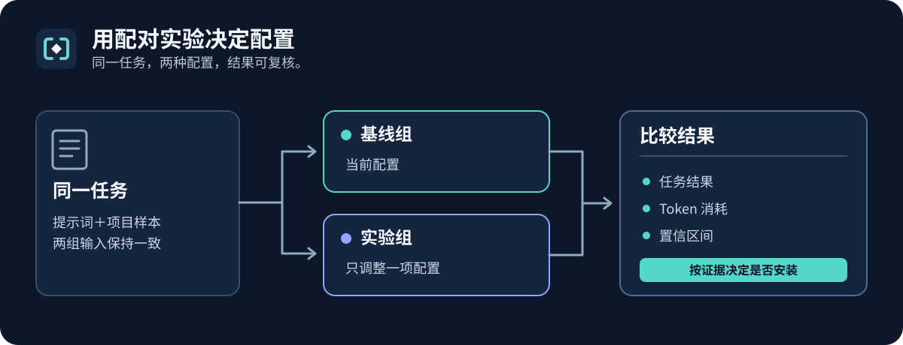

<div align="center">


# skillfit

**Skills 市场告诉你什么最热门，skillfit 告诉你什么真有用。**

在**你的** agent、**你的** 模型、**你的** 任务上实测某个 skill / 规则文件 / MCP 配置到底有没有用——<br/>
然后只装通过实验的那些。

[](LICENSE)
[](package.json)
[](https://github.com/remote-controlled-man/skillfit/actions/workflows/ci.yml)
[](package.json)
[](https://github.com/remote-controlled-man/skillfit/stargazers)

[English](README.md) · [简体中文](README.zh-CN.md)

[文档目录](docs/README.md) · [快速开始](#用-npm-开始) · [Bench 指南](benches/README.md) · [指标协议](docs/metrics.md) · [证据库](evidence/)

</div>

<p align="center">
  
</p>

---

## 为什么

Agent 配置生态已经解决了**分发**（`npx skills add`、插件市场、MCP 注册中心），但没解决**选型**。现有证据表明，未经验证的配置可能有害：

- 精选 Skill 在 87 个任务、18 种模型与执行框架组合中，平均提升通过率 **+16.6pp**；收益随组合而变化（[SkillsBench v4](https://arxiv.org/abs/2602.12670v4)）。
- LLM 生成的 context 文件未带来统计显著的成功率提升，平均推理成本在 **SWE-bench 上增加 20%、CTXbench 上增加 23%**（[Evaluating AGENTS.md v3](https://arxiv.org/abs/2602.11988v3)）。
- Snyk 在 2026 年 2 月 5 日的研究中发现，扫描的 **3,984 个公开 Skill 中有 36.82% 存在至少一种安全问题**（[ToxicSkills 研究结果](https://snyk.io/blog/toxicskills-malicious-ai-agent-skills-clawhub/)）。

skillfit 补上缺失的测量层：配对 A/B 实验 + 确定性 verifier + 统计判定 + 触发率测量，打包成任何人都能跑的 CLI。

围绕你自己的任务编写 case：固定初始文件、写下任务请求、定义正确结果必须满足的条件。内置 bench 用来教格式；CLI 负责运行你的 case、对比结果和成本、保存证据。参见[case 编写指南](docs/bench-authoring.md)。

## 你能得到什么

一次真实运行：skill 已安装但没人提醒时，agent 到底**想不想得起来用它**——

```console
$ node dist/cli.js eval ./skills/code-review --mode trigger --bench code-review --agent kimi-code

TASK        FIRE?  FIRED    UNKNOWN  ERRORS  PASS
review-r1   yes    1/3      0        0       3/3
review-r2   yes    0/3      0        0       3/3
review-r3   yes    0/3      0        0       3/3
explain-x1  no     0/3      0        0       3/3

Trigger recall      : 1/9 (11%) [95% CI 2%–44%]
False-trigger rate  : 0/3 (0%) [95% CI 0%–56%]
Precision           : 1/1 (100%) [95% CI 21%–100%]
F1                  : 0.20 (no CI: a harmonic mean of two proportions has no closed-form binomial interval)
```

9 个该触发的任务里它只被加载了一次——而且不加载也照样全做对。这种结论，应用市场给不了你。

<sub>2026-09-22 在 Kimi Code 上针对当时的 4 任务 `code-review` bench 抓取。该 bench 之后新增了第 5 个任务；上面四行指标是用那次运行记录的每任务计数重新渲染的——运行是真实的，格式是当前的。</sub>

## 安装

```bash
npx skillfit@0.13.0 --help
npx skillfit@0.13.0 doctor
```

需要 Node.js 22+。npm 可能先下载包；下面的 case 校验和预览不调用模型。

## 用 npm 开始

在项目目录执行，将 `./my-skill` 替换为包含自己 `SKILL.md` 的目录：

```bash
npx skillfit@0.13.0 bench init my-bench --kind command --dry-run
npx skillfit@0.13.0 bench init my-bench --kind command --yes
npx skillfit@0.13.0 bench check ./my-bench --json
npx skillfit@0.13.0 eval ./my-skill --bench ./my-bench --mode installed --agent codex --trials 1 --max-calls 2 --runs-root ./runs --run-group first-eval --json --dry-run
```

测收益前先把教学用 fixture、prompt、verifier 和 oracle 换成真实任务。预览声明两次调用，实际不调用。检查 `plan.evaluation.agentPreflight.status`；离线登录状态仍未知。case 与运行记录分开放。继续阅读[第一次真实评测](docs/first-real-eval.md)。

### 从源码运行

构建本地源码：

```bash
git clone https://github.com/remote-controlled-man/skillfit.git
cd skillfit
npm ci
npm run build
node dist/cli.js --help
node dist/cli.js bench check benches/code-review
node dist/cli.js bench check benches/debugging
node dist/cli.js doctor
node dist/cli.js eval skills/skillfit --bench code-review --agent codex --dry-run
node dist/cli.js install --agent codex --dry-run
```

校验离线执行；`doctor` 只读，两种预览都只展示计划。支持 **Claude Code**、**OpenAI Codex CLI**、**Kimi Code**（[能力矩阵](src/matrix/agents.json)）。

配对评测默认**5 次每组**：8 个任务会执行 80 次 agent，尚未包括可选 judge。花费前预览次数并设置 `--max-calls`。参见[有界实验流程](docs/experiment-workflow.md)。

## 创建自己的 case

生成代码修改教学 case，再替换成真实任务的输入：

```bash
node dist/cli.js bench init my-bench --kind command --dry-run
node dist/cli.js bench init my-bench --kind command --yes
node dist/cli.js bench check my-bench
node dist/cli.js bench check my-bench --json
node dist/cli.js eval skills/skillfit --bench my-bench --agent codex --input workspace --trials 1 --max-calls 2 --dry-run
```

用 `bench add --freeze` 记录失败，或用 `--from-commit` 导入修复。阅读[case 编写指南](docs/bench-authoring.md)、[JSON 校验契约](docs/bench-check-json.md)、[verifier 契约](docs/verifier-contract.md)和[起草记录](docs/bench-drafting.md)。

列出、查看 case 或预览修改。`--yes` 会备份并应用通过验证的变更；移除注册仍保留 case 文件。重复 `--task` 选择较小的运行范围：

```bash
node dist/cli.js bench list my-bench --json
node dist/cli.js bench show my-bench example-task --json
node dist/cli.js bench edit my-bench example-task --set shouldTrigger=true --json
node dist/cli.js eval skills/skillfit --bench my-bench --agent codex --task example-task --input workspace --trials 1 --max-calls 2 --dry-run
```

参见[case 管理](docs/case-management.md)。真实评测在调用前检查[case 完整性](docs/eval-case-preflight.md)和[Agent 环境](docs/eval-agent-preflight.md)；预览成功本身不代表环境就绪。

### 评估真实开源任务

CLI 使用 `--input workspace` 直接检查和修改磁盘文件。API 执行器需要默认 snapshot 模式。校准与配对评测保持相同输入模式：

```bash
node dist/cli.js eval <skill-dir> --bench <bench-dir> --agent codex --input workspace --trials 5 --dry-run
node dist/cli.js bench check <bench-dir> --calibrate --agent codex --input workspace --trials 3 --dry-run
```

导入时用 `--prompt-file` 保留 issue 请求，避免修复提交信息泄露答案。参见[真实 OSS 流程](docs/oss-task-evaluation.md)或[固定的 mcp-use 示例](benches/contrib/oss-mcp-use-utf8/README.md)。

### 比较 Skill 修订版本

比较 frontmatter 名称相同、指纹不同的两个完整版本。两组使用相同自然任务请求；修订效果与安装收益分开解释：

```bash
node dist/cli.js eval ./skill-new --baseline-skill ./skill-old --mode installed --bench ./my-bench --agent codex --trials 5 --dry-run
```

参见[修订比较](docs/skill-revisions.md)和[完整 Skill 交付](docs/installed-skill-evaluation.md)。

### Agent 评估组件

Agent 调用方可以预览版本 1 JSON 请求，再确认固定的计划执行：

```bash
node dist/cli.js eval --request ./request.json --dry-run
node dist/cli.js eval --request ./request.json --plan-sha <plan.sha256>
node dist/cli.js report eval ./runs/revision-validation-001 --json --replay
```

[组件契约](docs/eval-component.md)定义质量与效率策略；`accept`、`reject`、`inconclusive` 与统计 verdict 分开。采纳需要完整的独立验证，工具不自动升级。

[共享计划](docs/eval-planning.md)说明普通/请求计划、`--json`、任务选择、平衡组序、五项花费停止线、截止时间和计划哈希确认。校准测基线难度，trigger 测发现能力，两者都不能证明配对收益。installed 评测为两组提供相同且固定的 native diff 辅助工具。

### 测试规则与 MCP 配置

在 `skillfit-experiment.json` 旁准备基线组和实验组项目覆盖层：

```text
context7-experiment/
├── skillfit-experiment.json
├── baseline/.codex/config.toml
└── treatment/.codex/config.toml
```

```bash
node dist/cli.js eval ./context7-experiment --bench ./my-context7-bench --agent codex --trials 5 --dry-run
node dist/cli.js eval ./context7-experiment --bench ./my-context7-bench --agent codex --trials 5
```

先用 `skillfit mcp check` 做服务发现与工具目录检查，不调用工具。再按[规则与 MCP 流程](docs/config-experiments.md)测任务结果。Codex MCP 试验用单次运行的信任覆盖加载临时项目配置，不修改用户配置。

## 分享实验结果

先查看已有的合成报告，再换成自己运行打印的 manifest 或目录：

```bash
node dist/cli.js report eval docs/examples/eval-manifest.synthetic.json
```

Markdown 和 JSON 都能读取 paired、calibration、trigger 记录，包括不完整运行。生成报告不等于可以采纳。参见[结果分享](docs/sharing-results.md)、[报告状态](docs/evaluation-reports.md)和[成本覆盖](docs/eval-costs.md)。

把 sealed 运行导出到全新可迁移目录。先预览，`--yes` 才写入：

```bash
node dist/cli.js report eval ./runs/my-run --export ./exports/my-run --json
node dist/cli.js report eval ./runs/my-run --export ./exports/my-run --yes --json
node ./exports/my-run/reproduce.mjs --verify-only
node ./exports/my-run/reproduce.mjs
```

[可迁移回放](docs/replay-packages.md)验证保存的观察并执行可信本地 verifier，不调用模型。[固定输入](docs/evaluation-input-snapshots.md)保留原 case 与目标。[中断处理](docs/evaluation-interruption.md)保留可用花费，未知用量仍为未知。

0.13.0 增加显式的[归档恢复工具](docs/archive-delivery.md)：按固定版本下载一次，之后离线回放历史研究记录。Git 原件和冻结报告继续保留；正常安装和 CLI 命令不会下载归档。

## 可选择的 Codex 配置

先查看 67 个可安装源，再选择与任务相关的 Skill。`--starter` 选择尚未作为集合评测的 13 个 Skill，`--all` 选择全部 67 个。源哈希验证安装完整性，不代表收益。选择上游源需要网络，只有 `--yes` 安装：

```bash
node dist/cli.js setup codex --list
node dist/cli.js setup codex --skill vibe-coding --skill diagnosing-bugs
node dist/cli.js setup codex --skill vibe-coding --skill diagnosing-bugs --yes
```

[可选择配置指南](docs/selectable-codex.md)说明来源、退役条目和证据限制。

### 可迁移的 Codex 配置

导出至少在两次 Codex 会话中观察到的用户级 Skill 和当前全局指引：

```bash
node dist/cli.js bundle export ./personal-codex --dry-run
node dist/cli.js bundle export ./personal-codex --yes
# transfer the personal-codex directory to the new machine
node ./personal-codex/setup.mjs --dry-run
node ./personal-codex/setup.mjs --yes
```

完整 65 个 Skill 的上游目录可使用 `--upstream-lock`；其他选项参见[迁移配置](docs/portable-codex.md)和[源审计](docs/codex-upstream-audit.md)。

## 八个命令

| 命令 | 干什么 | 写文件？ |
|---|---|---|
| `doctor` | 探测已装 agent，检查规则膨胀、skill 合法性/冲突、MCP 声明是否存在及受支持格式的 JSON 语法，并检查静默失效坑（比如 Claude Code 根本不会读的 AGENTS.md） | 从不 |
| `report` | 从保留的本地会话历史统计 skill 使用：每个 skill 的触发次数、未观察到触发的候选项，以及 agent 限制前的原始目录规模。未观察到不等于无用，只是排查优先级信号。也可用 `report eval` 把已有实验清单渲染为 Markdown。 | `--export --yes` 写出全新回放目录；其余只读 |
| `eval <target>` | 对 Skill、规则覆盖层或 MCP 覆盖层做配对 baseline/treatment；包含确定性 verifier、可选盲评、token 成本、McNemar 精确检验、配对 bootstrap CI 和 facet 分数。`--mode trigger` 专门测 Skill 的触发召回率与误触发率 | 仅本地 `runs/` |
| `mcp check <spec>` | 与 stdio MCP server 或 Streamable HTTP 端点握手，请求 `tools/list`，检查工具名称、描述、输入 schema 与 annotations；从不调用工具 | 从不 |
| `bench` | `init` 生成带可运行示例任务的骨架；`check` 离线校验（verifier 自测、oracle/NOP 闸门、mock 臂探针、fixture 体积、触发标签覆盖）；`add --freeze` 把你刚目击的翻车冻成永久 bench 任务，`--decompose` 确认后调用一次 agent 起草 verifier + 参考解，两道闸门都过才接纳 | `init`/`add`/`edit`/`remove` 确认后写入；`check --calibrate` 调用 agent 并记录运行；普通 `check` 执行本地校验 |
| `install` | 受管区域规则写入（`<!-- SKILLFIT_START/END -->`，幂等）、skill 复制带冲突保护、内容哈希锁定的 lockfile、安装后校验。写入前先暂存；如果写入或校验失败，会回滚本次改动的目标文件，包括 lockfile。进程突然终止仍可能留下部分安装，可重新运行以协调状态。原文件保留在 `<file>.skillfit-bak`，且首份备份优先，后续更新不会覆盖它。`--dry-run` 会报告冲突并以 0 退出；加上 `--strict` 则让冲突失败（用于 CI 闸门） | 确认后才写 |
| `setup codex` | 列出或安装所选的固定版本上游 Skills、本仓库自写 Skills 和全局触发指引；默认只展示计划 | 仅 `--yes` 写入 |
| `bundle` | `export` 将用过的本地 Skills 和当前全局规则导出为可迁移的 Codex profile | 确认后才写 |

### 自带 bench

bench 包含 `bench.json`、fixtures 和确定性 verifier。参见[七步编写指南](docs/bench-authoring.md)与[格式参考](benches/README.md)；内置 case 用于教格式，不是模型质量证明。

## 我们自己的数据

我们用 skillfit 的 harness 测了 8 个流行的工作流 skill（24 组 baseline/treatment 配对，Codex CLI，2026-07 冻结基线）。其中 1 个在 3 次 treatment 中有 2 次出现回归测试资产信号；没有任何一个显示可靠的任务质量增益。这些实验不能验证当前的 67 个 Skill 目录，也不能验证原来的 13 个整套配置。报告标成 indicative 的运行也不是安装建议：

| Skill | 质量差值 | 输入 token | 结论 |
|---|---:|---:|---|
| `diagnosing-bugs` | 回归测试资产 +66.7pp（2/3 次）；任务质量不变 | +11.7% | 有限的历史流程信号 |
| `code-review` | +3.3pp（不稳定） | +9.1% | 证据不足 |
| `tdd` | 0.00pp | +9.2% | 无可测增益 |
| `doubt-driven-development` | 0.00pp | +20.7% | 无可测增益 |
| `security-and-hardening` | 0.00pp | +27.4% | 无可测增益，成本最高 |
| 其余 3 个 | 0.00pp | +14.7~17.0% | 无可测增益 |

参见[证据总索引](evidence/README.md)与[当前调试研究](docs/skill-evaluation-evidence.md)，了解各日期报告的范围和可用记录。

## 设计原则

- **站上标准，不造格式。** AGENTS.md（AAIF）、SKILL.md、`.agents/skills/`、`.mcpb`——只写 agent 本来就读的东西。
- **deny by default。** 只装 profile 显式声明的内容，按内容哈希锁定。
- **dry-run 优先。** 配置变更先预览再应用，替换已有配置时保留备份并验证。新建 bench、run、bundle 通过冲突检查保护已有输出。
- **诚实的数字。** 新的效果投稿需要固定版本且可分享的 manifest；部分旧报告没有可下载的原始 manifest。判定语义冻结在 [docs/metrics.md](docs/metrics.md)：显著性来自不一致对的 McNemar 精确检验，差值带配对 bootstrap 置信区间；低于 8 个任务 × 每组 5 次的运行标为 *indicative*，即使它在该 bench 内达到统计显著。

### 免责声明

与 Anthropic、OpenAI、Moonshot AI 或任何 agent 厂商无关联。评测结果依赖模型版本、harness 和任务——把它们当带日期的证据，不是永恒的真理。

## Roadmap

参见[十月交付路线图](docs/growth-roadmap-2026-10.md)、[更新记录](CHANGELOG.md)和[0.13.0 发布记录](docs/releases/0.13.0.md)。

后续工作包括验证 Claude Code trigger 捕获和增加 Agent 适配器。[证据总索引](evidence/README.md)与[调试研究状态](docs/skill-evaluation-evidence.md)保留当前结论的限制。67 个 Skill 的目录和 13 个 Skill 的入门集均未作为集合评测。

## 贡献

按 [CONTRIBUTING.md](CONTRIBUTING.md) 贡献真实工作 case、可复现证据和矩阵修正。[安全报告](SECURITY.md)有独立渠道。

### License

[MIT](LICENSE)
