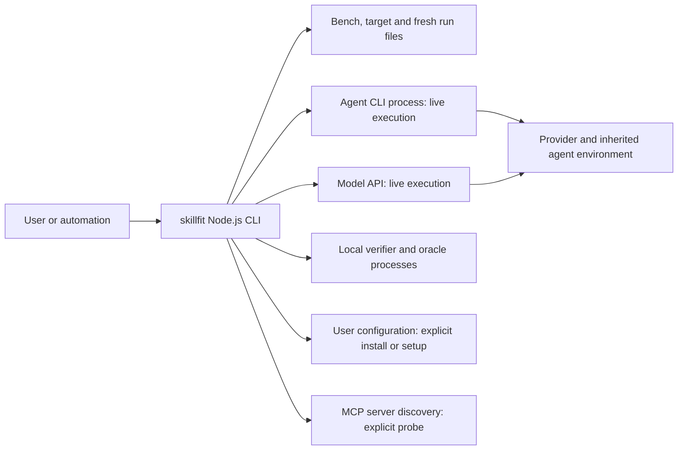
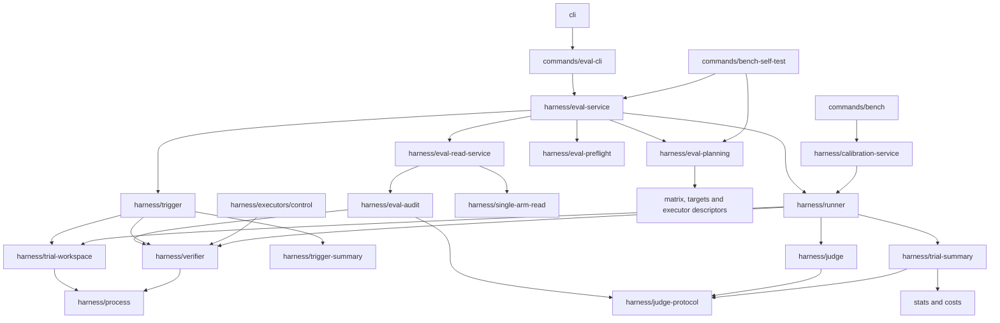

# Architecture boundaries

This page distinguishes the current source implementation from the target
design in the [governance plan](plans/2026-10-22-documentation-governance-and-architecture.md).
A2 has extracted the shared mechanisms and pure summaries described below; A3 adds evaluation/read application services; A4/A5 remain proposed. The
[architecture entry](architecture.md), [runtime scenarios](architecture-runtime.md)
and [interfaces](architecture-interfaces.md) cover complementary views.

## System context: current implementation

skillfit is a Node.js CLI process. Its two product workflows are measurement
and agent configuration. Execution, local file access and an external provider's
behavior are different boundaries; pinning one does not isolate the others.

| Boundary | What the current implementation controls | Limit |
| --- | --- | --- |
| User/automation → CLI | Argument combinations, request parsing, plan confirmation where required, output/exit adaptation | Entry points have different confirmation contracts; see [interfaces](architecture-interfaces.md#current-entry-contracts) |
| CLI → Agent CLI/API | Matrix-backed command templates or API requests, executor deadline, public output/usage/identity capture | Offline preflight cannot establish authentication, provider availability or a hidden served model |
| CLI → verifier/oracle | Parsed argv without shell interpolation, cwd, disposable fixture, deadline, output bounds and process cleanup | Verifiers/oracles are executable local programs, not sandboxed or inherently network-free |
| Run → inherited configuration | Recorded matrix paths, settings, Skill inventories and change guards | This is not a hermetic agent environment; unlisted tools/plugins and provider changes can remain unrecorded |
| CLI → actual user configuration | Install/setup transaction with confirmation, backups, validation and rollback | Fresh run artifacts use collision protection; they do not share an installer's existing-target backup requirement |
| CLI → MCP discovery | Explicit handshake and tool catalog inspection | Discovery does not call a tool or establish its effectiveness; a server process can have its own startup behavior |

Offline tests use injected executors, temporary roots and local fixture programs.
Architecture documentation does not authorize any live invocation or user
configuration change. Agent capabilities come from the [matrix](../src/matrix/agents.json)
and [capability table](eval-agent-preflight.md#current-source-capability-table).

## Current component dependencies

The following is a selected **runtime import** view, not the desired layering
or a full call graph. Arrows mean the source module imports the destination.
This view selects the modules relevant to A2/A3; the compiled graph check covers
all active modules, excluding tests and frozen historical runtimes.

The [legacy planner](../src/commands/eval-plan.ts) now delegates to
[read-only resolution and pure construction](../src/harness/eval-planning.ts)
and a separate presenter. It no longer calls `runEval(dryRun: true)` or captures
text. [Application dispatch](../src/harness/eval-service.ts) owns shared execution
and request orchestration; [saved reads](../src/harness/eval-read-service.ts) own
audit/assessment without importing experiment execution. Calibration keeps an
independent baseline application contract. [Runner](../src/harness/runner.ts) owns paired trial/experiment
orchestration and receipts. [Process](../src/harness/process.ts),
[verifier](../src/harness/verifier.ts) and [workspace](../src/harness/trial-workspace.ts)
now provide the shared mechanisms used by trigger, bench checks, controls and replay.
[Trial summary](../src/harness/trial-summary.ts),
[judge protocol](../src/harness/judge-protocol.ts) and
[trigger summary](../src/harness/trigger-summary.ts) perform calculation without
execution. Audits use these directly. Runner/judge/trigger preserve their old
exports; the judge prompt wrapper alone supplies the historical random nonce default.
Evaluation planning/dispatch/read have moved in A3; authoring remains command-owned until A4.

## Target dependency roles: proposed

The target is responsibility-based separation within the existing CLI. It does
not require a new runtime framework, package split or moving every file.
“Allowed” below defines the target, not an A1-enforced rule. A5 owns executable
classification and enforcement; mixed modules require extraction before being
declared pure.

| Role | Intended responsibility and examples | May depend on | Must not depend on |
| --- | --- | --- | --- |
| Contracts | DTOs, neutral options/plan types, pure validation | Other contracts/pure validation | commands, concrete executor instances, I/O or environment probes |
| Calculation | Statistics, cost aggregation, pure judge/task summaries | Contracts and calculation | I/O, implicit environment/clock/randomness, execution or presentation adapters |
| I/O mechanisms | Process lifecycle, verifier invocation, workspace operations, hashing | Contracts, calculation and Node built-ins | runner/trigger/session, application services or commands |
| Agent integration | Matrix resolution, CLI/API executors, MCP discovery | Contracts, I/O and pure parsing | Experiment scheduling, application services or commands |
| Evidence | Receipt formats, input snapshots, saved parsing/audit and replay I/O | Contracts, calculation and I/O/verifier | Model invocation, commands or experiment orchestration |
| Execution | runner, trigger, session and judge orchestration | Contracts, calculation, I/O, integration and evidence operations | CLI rendering, interactive confirmation or command adapters |
| Application | Resolve/build/dispatch evaluation; read/assess evidence; prepare/apply bench changes | Required lower roles through explicit interfaces | commands, console/exit/interactive UI or a competing public schema |
| Entry/presentation | CLI, request adapters, presenters and compatibility wrappers | Application, contracts and pure views; composition may assemble concrete adapters | Duplicated measurement policy or separate business implementations |
| Installation transaction | Existing `install/` transaction and constants | Its independent existing foundations | Evaluation-specific behavior or command adapters |

MCP probe belongs to Agent integration once; it is not a second installation
layer. Evidence reads can run retained verifiers during explicit replay, but
must not invoke an Agent/model. Formatting a summary is distinct from computing
it. Some current files contain both; filenames alone do not establish a layer.

## Migration and debt ownership

| ID / stage | Current responsibility to migrate | Target and compatibility obligation | Main risk / observable acceptance |
| --- | --- | --- | --- |
| B1 / A2 | Delivered: process/verifier/workspace extracted from runner | Shared lower-level modules now serve execution, checks, controls and audit; old runner exports re-export the same implementation | Preserve argv/cwd/env, timeout/output/error classification and descendant cleanup; existing [verifier](../src/harness/verifier.test.ts), [timeout](../src/harness/verifier-timeout.test.ts) and [self-test](../src/commands/bench-self-test.test.ts) cases |
| B2 / A2 | Delivered: judge protocol and paired/trigger summaries extracted | Saved audit imports pure helpers directly; old exports preserve class identity and formulas | Evidence no longer needs execution modules for helpers; [judge accounting](../src/harness/judge-accounting.test.ts) and [report](../src/commands/eval-report.test.ts) behavior unchanged |
| B3 / A3 | Delivered: planning, run dispatch and saved report orchestration extracted | Resolve/build/execute and saved-read application interfaces; neutral types and compatible command exports | Preserve all entry-specific confirmation, serialized plan/context and stopped-result rules; [CLI usage](../src/commands/eval-cli-usage.test.ts), [component](../src/harness/eval-component.test.ts), [self-test](../src/commands/bench-self-test.test.ts) |
| B4 / A4 | bench command templates, Git capture, draft coordination and apply logic | Reuse existing source/draft/manage implementations behind prepare/apply service | No hidden drafting call; collision, provenance, backup/rollback and F7 schema rules preserved; [source](../src/commands/bench-source.test.ts), [draft](../src/commands/bench-draft.test.ts), [management](../src/commands/bench-manage.test.ts) |
| B5 / A5 | Only top-level runtime cycles/core direction are checked today | Register every active module, classify runtime/type edges, allow only narrow temporary exceptions | Migrated scope has no remaining exceptions; [architecture regression tests](../scripts/check-architecture.test.mjs) must gain the proposed counterexamples |
| B6 / D2/D3 | D3 registry/impact/CI gate and D2 content consolidation delivered; F5 whole-phase/F3 acceptance pending | Preserve canonical topics/anchors and consume the D1 registry in real checks | New/unregistered docs, authority conflicts and unsafe aliases rejected; historical pages stay historical |

A3 follows F7 local implementation and F5 content synchronization. A4/A5 remain
open as defined in the [dependency plan](plans/2026-10-22-documentation-governance-and-architecture.md#与-f1f8-的衔接与依赖).
F3 remote CI and F5 whole-phase acceptance remain pending; source extraction
does not complete those tasks.

## Enforcement today

[check-architecture](../scripts/check-architecture.mjs) reads emitted JavaScript
and rejects runtime cycles plus `harness/` or `install/` imports of `commands/`,
including literal dynamic imports. It does not enforce this target role table,
classify all source type edges, or prove side-effect freedom. A passing result
supports only those existing rules. A2 adds a focused regression proving the shared
mechanisms, controls and audits cannot transitively load runner/judge/trigger;
A3 extends this regression to planning and saved-read services. This is not the A5 role/type/effect gate. Source/import evidence is reviewed separately.

[ADR 0002](decisions/0002-layering-and-shared-execution.md) records the proposed
tradeoff and alternatives. The [quality scenarios](architecture-runtime.md#quality-scenarios)
connect each architectural requirement to a verification location.
