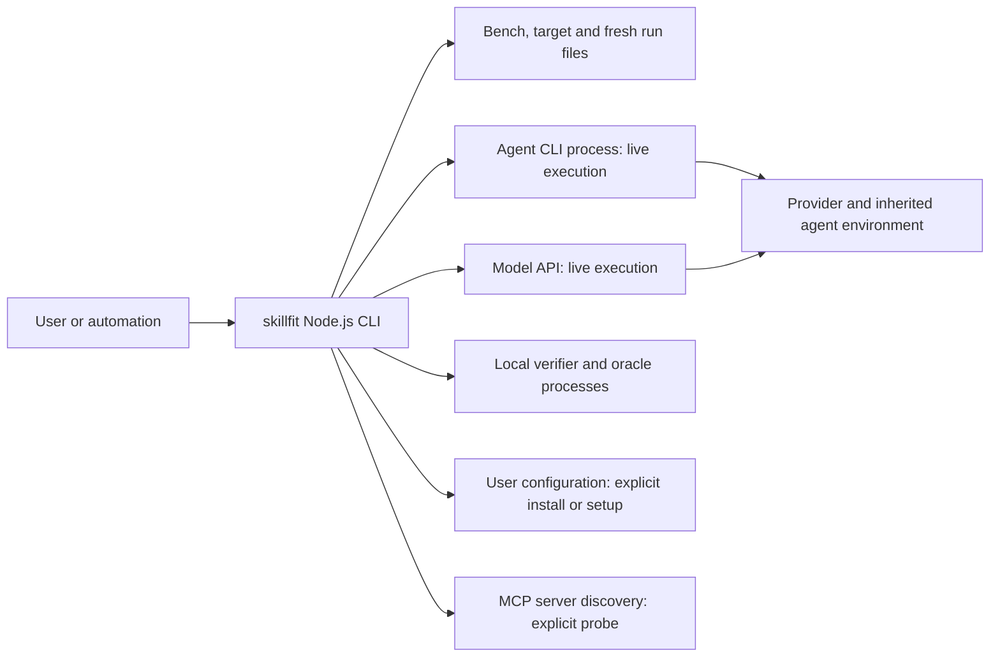
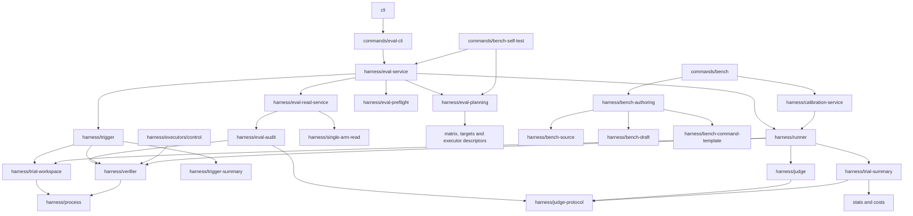

# Architecture boundaries

This page distinguishes the current source implementation from the target
design in the [governance plan](plans/2026-10-22-documentation-governance-and-architecture.md).
A2 extracted shared mechanisms and pure summaries; A3/A4 add evaluation/read and authoring interfaces; A5 enforces the registered runtime/type/effect rules. The
[architecture entry](architecture.md), [runtime scenarios](architecture-runtime.md)
and [interfaces](architecture-interfaces.md) cover complementary views.

## System context: current implementation

skillfit is a Node.js CLI process. Its two product workflows are measurement
and agent configuration. Execution, local file access and an external provider's
behavior are different boundaries; pinning one does not isolate the others.

| Boundary | What the current implementation controls | Limit |
| --- | --- | --- |
| User/automation → CLI | Argument combinations, request parsing, plan confirmation where required, output/exit adaptation | Entry points have different confirmation contracts; see [interfaces](architecture-interfaces.md#current-entry-contracts) |
| CLI → Agent CLI/API | Matrix-backed command templates or API requests, executor deadline, public output/usage/identity capture | Offline preflight cannot establish authentication, provider availability or a hidden served model |
| CLI → verifier/oracle | Parsed argv without shell interpolation, cwd, disposable fixture, deadline, output bounds and process cleanup | Verifiers/oracles are executable local programs, not sandboxed or inherently network-free |
| Run → inherited configuration | Recorded matrix paths, settings, Skill inventories and change guards | This is not a hermetic agent environment; unlisted tools/plugins and provider changes can remain unrecorded |
| CLI → actual user configuration | Install/setup transaction with confirmation, backups, validation and rollback | Fresh run artifacts use collision protection; they do not share an installer's existing-target backup requirement |
| CLI → MCP discovery | Explicit handshake and tool catalog inspection | Discovery does not call a tool or establish its effectiveness; a server process can have its own startup behavior |

Offline tests use injected executors, temporary roots and local fixture programs.
Architecture documentation does not authorize any live invocation or user
configuration change. Agent capabilities come from the [matrix](../src/matrix/agents.json)
and [capability table](eval-agent-preflight.md#current-source-capability-table).

## Current component dependencies

The following is a selected **runtime import** view, not the desired layering
or a full call graph. Arrows mean the source module imports the destination.
This view selects the modules relevant to A2–A4; the compiled graph check covers
all active modules, excluding tests and frozen historical runtimes.

The [legacy planner](../src/commands/eval-plan.ts) now delegates to
[read-only resolution and pure construction](../src/harness/eval-planning.ts)
and a separate presenter. It no longer calls `runEval(dryRun: true)` or captures
text. [Application dispatch](../src/harness/eval-service.ts) owns shared execution
and request orchestration; [saved reads](../src/harness/eval-read-service.ts) own
audit/assessment without importing experiment execution. Calibration keeps an
independent baseline application contract. [Runner](../src/harness/runner.ts) owns paired trial/experiment
orchestration and receipts. [Process](../src/harness/process.ts),
[verifier](../src/harness/verifier.ts) and [workspace](../src/harness/trial-workspace.ts)
now provide the shared mechanisms used by trigger, bench checks, controls and replay.
[Trial summary](../src/harness/trial-summary.ts),
[judge protocol](../src/harness/judge-protocol.ts) and
[trigger summary](../src/harness/trigger-summary.ts) perform calculation without
execution. Audits use these directly. Runner/judge/trigger preserve their old
exports; the judge prompt wrapper alone supplies the historical random nonce default.
Evaluation planning/dispatch/read moved in A3. A4 now routes init/add/edit/remove through [authoring preparation/application](../src/harness/bench-authoring.ts); commands retain rendering/confirmation, and drafting remains an explicit bounded step.

## Enforced dependency roles

The target is responsibility-based separation within the existing CLI. It does
not require a new runtime framework, package split or moving every file.
The [A5 policy](../scripts/architecture-policy.json) assigns every active module
one role and lists runtime/type directions separately. The table describes
runtime ownership. Erased type annotations may reference lower-role DTOs without
loading their implementation; they still cannot point back to command, application
or execution owners from lower roles. Shared session/preflight DTOs now have
neutral owners. Mixed modules are not declared pure.

| Role | Intended responsibility and examples | May depend on | Must not depend on |
| --- | --- | --- | --- |
| Contracts | DTOs, neutral options/plan types, pure validation | Other contracts/pure validation | commands, concrete executor instances, I/O or environment probes |
| Calculation | Statistics, cost aggregation, pure judge/task summaries | Contracts and calculation | I/O, implicit environment/clock/randomness, execution or presentation adapters |
| I/O mechanisms | Process lifecycle, verifier invocation, workspace operations, hashing | Contracts, calculation and Node built-ins | runner/trigger/session, application services or commands |
| Agent integration | Matrix resolution, CLI/API executors, MCP discovery | Contracts, I/O and pure parsing | Experiment scheduling, application services or commands |
| Evidence | Receipt formats, input snapshots, saved parsing/audit and replay I/O | Contracts, calculation and I/O/verifier | Model invocation, commands or experiment orchestration |
| Execution | runner, trigger, session and judge orchestration | Contracts, calculation, I/O, integration and evidence operations | CLI rendering, interactive confirmation or command adapters |
| Application | Resolve/build/dispatch evaluation; read/assess evidence; prepare/apply bench changes | Required lower roles through explicit interfaces | commands, console/exit/interactive UI or a competing public schema |
| Entry/presentation | CLI, request adapters, presenters and compatibility wrappers | Application, contracts and pure views; composition may assemble concrete adapters | Duplicated measurement policy or separate business implementations |
| Installation transaction | Existing `install/` transaction and constants | Its independent existing foundations | Evaluation-specific behavior or command adapters |

MCP probe belongs to Agent integration once; it is not a second installation
layer. Evidence reads can run retained verifiers during explicit replay, but
must not invoke an Agent/model. Formatting a summary is distinct from computing
it. Some current files contain both; filenames alone do not establish a layer.

## Migration and debt ownership

| ID / stage | Current responsibility to migrate | Target and compatibility obligation | Main risk / observable acceptance |
| --- | --- | --- | --- |
| B1 / A2 | Delivered: process/verifier/workspace extracted from runner | Shared lower-level modules now serve execution, checks, controls and audit; old runner exports re-export the same implementation | Preserve argv/cwd/env, timeout/output/error classification and descendant cleanup; existing [verifier](../src/harness/verifier.test.ts), [timeout](../src/harness/verifier-timeout.test.ts) and [self-test](../src/commands/bench-self-test.test.ts) cases |
| B2 / A2 | Delivered: judge protocol and paired/trigger summaries extracted | Saved audit imports pure helpers directly; old exports preserve class identity and formulas | Evidence no longer needs execution modules for helpers; [judge accounting](../src/harness/judge-accounting.test.ts) and [report](../src/commands/eval-report.test.ts) behavior unchanged |
| B3 / A3 | Delivered: planning, run dispatch and saved report orchestration extracted | Resolve/build/execute and saved-read application interfaces; neutral types and compatible command exports | Preserve all entry-specific confirmation, serialized plan/context and stopped-result rules; [CLI usage](../src/commands/eval-cli-usage.test.ts), [component](../src/harness/eval-component.test.ts), [self-test](../src/commands/bench-self-test.test.ts) |
| B4 / A4 | Delivered: neutral authoring, source capture, templates and explicit drafting | Reuse existing source/draft/manage implementations behind prepare/apply service | No hidden drafting call; collision, provenance, backup/rollback and F7 schema rules preserved; [source](../src/commands/bench-source.test.ts), [draft](../src/commands/bench-draft.test.ts), [management](../src/commands/bench-manage.test.ts) |
| B5 / A5 | Delivered: 107 module registrations, runtime/type/effect checks | The real policy runs through the existing offline test/CI surface | Migrated scope has zero exceptions; the one unmigrated legacy edge is listed below and fails when stale |
| B6 / D2/D3 | D3 registry/impact/CI gate and D2 content consolidation delivered; F5/F3 accepted on their recorded source CI | Preserve canonical topics/anchors and consume the D1 registry in real checks | New/unregistered docs, authority conflicts and unsafe aliases rejected; historical pages stay historical |

A3/A4 followed F7 local delivery and F5 synchronization. F3/F5 acceptance is
recorded in the measurement plan; new changes do not inherit old CI results.
V1/F8 completion and current inputs belong to the [dependency plan](plans/2026-10-22-documentation-governance-and-architecture.md#与-f1f8-的衔接与依赖).

## Enforcement today

[check-architecture](../scripts/check-architecture.mjs) checks emitted runtime
imports/re-exports/literal dynamic imports and cycles, plus the separate source
type graph. Unknown/overlapping roles, unresolved modules and stale exceptions
fail. Nonliteral imports require an exact declared target set verified from
literals, immutable local aliases or conditional branches; unbounded expressions
fail even with a declaration. Type-only cycles are not runtime cycles.

Pure-role checks cover Node I/O imports and direct environment/clock/random
reads; application checks cover console output, process exit and interactive
module dependencies. The AST follows immutable local aliases, destructuring,
constant member access and imported aliases with lexical shadowing. It ignores
strings/comments, including generated verifier programs, and permits explicit
date parsing. Computed reflection, arbitrary callback effects, mutation-based
aliases and arbitrary interprocedural behavior are outside this static check;
it is not a proof of universal effect freedom.

The one legacy runtime exception is `harness/eval-contract.js -> agents.js`:
the mixed request parser validates Agent IDs through the matrix reader. Owner:
`evaluation`; removal: extract matrix-only Agent-ID validation. This
module no longer imports a concrete executor merely for a timeout constant.
Saved Agent/trigger metadata parsing has separate pure owners, so audits do not
need live discovery for those operations. No exception originates in the
registered A2–A4 migrated modules; new edges cannot borrow the legacy entry.
Exceptions require exact from/to/kind/reason/owner/removal task and fail when
unused or attached to a migrated module.

`npm test` builds first and executes the actual policy; full CI already invokes
that test surface. Keep the focused transitive regression preventing shared
mechanisms, controls, audits, planners and saved readers from loading experiment
orchestration. Build before invoking the standalone checker; frozen runtimes
and the private lab are outside its inventory.

[ADR 0002](decisions/0002-layering-and-shared-execution.md) records the accepted
tradeoff and alternatives. The [quality scenarios](architecture-runtime.md#quality-scenarios)
connect each architectural requirement to a verification location.
