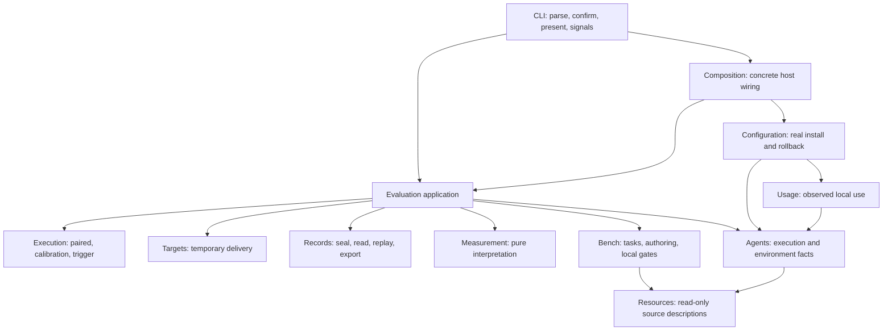

# skillfit architecture

skillfit is one TypeScript/Node >=22 ESM CLI with zero runtime dependencies.
This page explains the current system and the contracts changes must preserve.
Execution order, progress and validation live only in the
source-only `docs/work/current.md` (not shipped in npm).
Current source includes unpublished changes beyond npm 0.13.1.

Start with the map, module owners and workflows. Use the later compatibility,
retention and extension rules when changing one of those modules.

## Architecture at a glance



Arrows show selected caller relationships, not every allowed import. Shared
mechanisms sit below business modules. Evaluation never calls the real
Configuration writer: temporary Target delivery has different write policy.

Agent environment facts and health collection belong to Agents; doctor formats
the report and Records fingerprints declared files. Records owns typed, validated
Session details without changing saved formats. Trigger text is rendered in CLI;
presentation does not load the experiment scheduler. These responsibilities are
checked through caller regressions and the current plan's local acceptance.

## Modules and dependency roles

| Module | Responsibility and allowed business dependencies |
| --- | --- |
| Resources | Read/validate/fingerprint Skill, rules and MCP bytes. Shared only; no install, model call or verdict. |
| Agents | Matrix, capabilities, executors, invocation accounting, vendor decoding and environment interpretation. Shared and Resource contracts; no experiment policy or real-config transaction. |
| Usage | Aggregate normalized Agent observations and Resource inventories. No Configuration/Evaluation dependency. |
| Bench | Load/author tasks and run local gates. Resources/shared and an injected Agent executor for authorized drafting; no Evaluation dependency. |
| Evaluation | Use Bench, Resources and Agents; own Application, Targets, Execution, Measurement and Records. No Configuration writer. |
| Configuration | Selection/planning and real user installation/rollback, using Resources, Agents and Usage. No Evaluation dependency. |
| CLI / Composition | CLI owns parsing, confirmation, presentation, OS signals and exit behavior. Composition connects operations to concrete host adapters. Business modules never import either. |
| Shared | Explicit-input process/path/hash mechanisms. No business imports, discovery, UI, exit or policy text. |

Within Evaluation, Application coordinates Execution, Targets, Records and
Measurement. Measurement is pure; Records owns saved codecs, sealing, audit and
readers, not another live scheduler. Calibration and control self-test belong to
Evaluation even when the CLI command starts with `bench`.

[Architecture policy](https://github.com/remote-controlled-man/skillfit/blob/ed5eaff7d222de1c73874ce022785fbe89291017/tools/verify/architecture-policy.json)
registers each active file once by business owner and technical role: contracts,
calculation, mechanisms, integration, evidence, execution, application, entry,
configuration or installation. Runtime and type dependencies are checked
separately. Unknown/overlapping owners, private imports, unresolved targets,
runtime cycles and stale exceptions fail; there are no legacy role exceptions.

The bounded AST check rejects direct I/O and implicit environment/clock/random
reads in pure roles, UI/exit in Application, host policy in Shared, Resource
writes and vendor wireShape access outside Agents. It follows immutable aliases,
destructuring, imported aliases and lexical shadowing, not arbitrary callbacks,
reflection, mutable aliases or general interprocedural effects. Literal and
verified finite dynamic targets join dependency checks. A passing gate proves
these rules, not that every responsibility has the right owner.

<a id="target-source-and-document-structure"></a>

## Source and document structure

```text
src/
  cli/ + composition.ts   host entry, presentation and concrete wiring
  resources/              read-only descriptions, inventories and fingerprints
  agents/                 capabilities, execution and environment/observation facts
  usage/                  local observation aggregation
  bench/                  tasks, authoring, claims, controls and gates
  configuration/          profiles, upstream, install/setup/bundle and transaction
  evaluation/
    application/          prepare/execute/read/export/self-test use cases
    targets/              freeze/deliver/verify temporary treatments
    execution/            experiment scheduling and stop rules
    measurement/          pure statistics, costs and acceptance interpretation
    records/              sealing, codecs, audit and portable/legacy replay
  shared/                 explicit-input mechanisms
  commands/ + harness/    retained recipe/replay delegates and six test entries

tools/{verify,release}/
docs/{guides,reference,maintainers,work,schemas,examples,assets}/
benches/                  reusable task inputs and provenance
profiles/                 installation inputs
skills/                   shipped CLI driver
runs/                     ignored attempts/exports/release workspaces
```

Each topic has one canonical page; `docs/work/current.md` is the only plan.
The docs index routes readers to task guides, references, maintenance contracts
and the sole plan. Bench format/claims stay with benches.
The docs index owns build/version availability; fixed Git snapshots retain retired
paths. CLI owns help and parser declarations in `src/cli/definition.ts`;
`tools/verify/cli-reference.mjs` derives selected reference rows and local tests
reject drift. Schemas and runnable fixtures remain testable contracts. Do not reproduce every
subfolder in every module or collect business types in Shared. Builds compile
into an owned temporary directory before replacing dist, removing stale modules
while preserving the last successful build on compilation failure. Distribution
roots come from one package-layout helper, with explicit caller overrides.

## Evaluation lifecycle

1. Resolve inputs and executor descriptions without a run, grader or model call.
2. Build a preview binding inputs, implementation digest and request/policy/
   self-test context. Changed implementation requires a fresh reviewed plan.
3. Preserve entry-specific confirmation: JSON requests bind the digest;
   ordinary text CLI retains its existing confirmation contract.
4. Recheck inputs, environment, implementation and collisions. Run case gates
   before a paid call or fresh session.
5. Record every attempted agent/judge/drafter invocation, available costs,
   configured intent and observed model identity. Unknown stays unknown.
6. Seal completed/stopped/incomplete facts. Report, verdict and adoption are
   distinct; synthetic runs never authorize adoption.

`resolveEvalInputs`, `buildEvalPlan`, `executeEvalPlan` and `readEvaluation` are
internal interfaces. Calibration keeps its independent baseline plan and
`planSha256`; trigger keeps single-arm interpretation. CLI owns signal listeners;
run/authoring hosts own stop, cost retention and sealing policy. Shared processes
receive cancellation/deadline inputs and preserve argv/cwd/env, output bounds,
errors and descendant cleanup. The narrow asynchronous signal scope is not a
global business context. A sealed stopped result survives host interruption.

## Bench authoring

`prepareBenchChange` plans init/add/edit/remove with source/target fingerprints,
without UI, verifier or model calls. `draftBenchChange` is separately authorized
and bounded, retaining costs/identity/failures. `applyBenchChange` rechecks inputs,
validates, backs up and rolls back. Public previews cannot mutate private write
bytes. Rejected post-draft apply still finalizes its summary; partial starter
writes remove only owned files. Edit/remove preserve unregistered task files.

## Write and evidence contracts

Real configuration writers plan, support dry runs, confirm or accept `--yes`,
back up existing targets, verify and roll back write/validation failure. Existing
explicit upstream fetch during Configuration selection/preview is preserved.
Fresh run/bundle/bench outputs instead reject collisions; evaluation fixtures are
disposable copies. Repository edits use Git review/checks. Never clean ignored
workspaces wholesale: `workspace4skills/` is a private lab.

Published bytes remain at fixed Git commits. Current source has no repository
archive catalog/restorer or mandatory historical-study release stage. Preserve
current saved-result readers and portable replay, including their original
runtime requirements. [Metrics](../reference/metrics.md) owns verdict/statistical
semantics; [Bench format](../../benches/README.md) owns reusable task inputs.

## Domain terms and owners

| Term | Meaning / owner |
| --- | --- |
| Resource | Skill/rules/MCP source bytes and metadata; Resources. Injectable-text and full-resource hashes differ. |
| Target | Resource treatment/baseline; Evaluation Targets freezes and delivers it temporarily. Real installation belongs to Configuration. |
| Bench | Tasks, fixtures, verifiers, oracles, claims and controls; Bench, without Run orchestration. |
| Run | Reviewed attempted execution and completed/stopped/incomplete facts; Execution schedules, Records retains and seals. |
| Usage | Local invocation/coverage observations; Usage. Activation alone does not prove efficacy. |
| Report | A projection of saved Run/Usage facts, not a new observation. Verdict and usage summary remain distinct. |
| Evidence | Explicitly published scoped results with identified Runs, payload/runtime hashes, replay requirements and limitations. A Run is not automatically Evidence. |
| Release | Software delivery and source/installation proofs, separate from efficacy Evidence. |

## Extension contracts and effects

Experiment design, Resource kind, delivery, claim and synthetic control are
independent axes. Validate supported combinations before dispatch; do not make
one mode enum govern every axis or change legacy public mode strings, JSON
order, defaults or entry-specific confirmation to simplify the implementation.
Agent adapters own wire/session/identity decoding. Declared capability, locally
checked availability and actual call coverage differ; missing usage still stops
under strict budget. Both primary/judge requirements enter preflight. New
observations retain hashes and final/partial/unknown scope; configured identity
never substitutes for served identity.

| Operation | Effects |
| --- | --- |
| Evaluation prepare | Read and return fingerprinted plan; no grader/model dispatch or run creation. |
| Evaluation execute | Recheck confirmed inputs, run local gates, make bounded explicit calls, seal terminal/partial facts. |
| Records read/replay/export | Verify bytes before reading; explicit replay runs trusted pinned/local graders, never Agents. Export previews and writes a fresh external destination. |
| Bench load/gate/draft/apply | Load does not grade; gates run tools; drafting is separately authorized; apply rechecks and preserves rollback. |
| Configuration prepare/apply | Selection may explicitly fetch upstream; no target write before confirmation; apply backs up, verifies and rolls back. |

Preview, failure, cancellation and repeated apply are interface contracts.
Registrations belong to owners and are wired once, not found by runtime scanning.
Do not introduce a universal runner, store, global type bag or context/container.

## Format, identity and replay compatibility

Records owns kind/version dispatch through `src/evaluation/records/formats.ts`,
including the explicit legacy summary adapter and replay runtime requirements.
Readers, exporter, portable validation and serialized launcher share it. Paired
and single-arm audits remain independent. Supported formats: native plan/summary v1, paired manifest v4
and portable descriptor v1 keep their meanings. Unknown versions fail clearly;
legacy filename/field inference stays in legacy adapters. Verify original bytes
before decoding; normalization cannot prove an original digest. Missing legacy
claims/usage/identity stay unrecorded, without today's metadata filling gaps.

Resource hash, plan digest, implementation digest, format version, statistical
protocol and npm version identify different things. Fingerprint all relevant
runtime; moving modules must not exclude them to retain an old approval. Pure
rendering may change presentation, never observations or recorded interpretation.
An alternative assessment identifies its own policy/implementation.

Installed recipes and generated replay launchers depend on paths such as
`harness/interruption.js`. Keep their exact-contract delegates and same error
class identity, not duplicate implementations. They are compatibility interfaces,
not extension points. Removal needs explicit reader/format migration. New formats
ship readers first; old archives retain their original readers and runtimes.
New Session details use a Records-owned typed writer contract. Behavior-driving
flags and implementation identities are validated before writes/probes; legacy
readers keep their recorded fields and inference rules. The current writer must
not use an untyped metadata dictionary as a control channel.
Test built, installed and relocated packages, not only source imports.

## Artifact lifecycle and admission to main

| Artifact | Owner and retention |
| --- | --- |
| Source/tests/Bench inputs/schemas | Canonical owning tree; retain reusable inputs and actual regression consumers. |
| Native Run facts and sealed inputs/runtime | Records; immutable batch directory, including failed/stopped observations. |
| Derived analyses, reports and temporary work | Explicit siblings outside sealed batches; retain methods/results only while consumed. |
| Shared evaluation | Complete verified export for an actual recipient/claim; state interpretation and availability limits. |
| Release proofs | One external proof bundle per attempt; source keeps changelog/current links, never imports receipts. |
| Current work | One ordered plan; replace status/results and link prior details instead of appending transcripts. |

The [experiment workflow](../guides/experiment-workflow.md#store-process-data-and-analysis)
owns the outer workspace, observed/derived process-data rules and explicit manual
retention/cleanup procedure. Completion status and retention intent are separate.
No automatic cleanup, custom telemetry facility or shared storage platform is
implied. Current export copies native inputs/runtime and does not automatically
package external analysis. A sealed transcript or trial workspace is not scratch.

Agents supplies observable facts, Execution attaches invocation context, Records
owns saved formats, Measurement derives metrics and CLI presents them. New raw
process observations require versioned reader/writer support; do not add an untyped
control dictionary. Reuse existing owners when a real measurement need appears.

Release proofs establish package delivery; Runs establish scoped task observations.
Release acceptance checks installed behavior/current portable replay, never old
personal studies. A failed Run stays in its explicit workspace without creating
a new source page/catalog or mandatory release check. Retained standalone
packages stay self-contained; copies are not removed by editing sealed indices.

## Growth controls and extension acceptance

Existing checks enforce purpose/ownership, one plan, no executable recipes in
docs, no generated trees in source/npm and explicit writer destinations. Version/
Skill checks require no per-version page. Registering a file does not justify it;
a new page needs a recurring task/contract and owner. Verify actual package
contents and dependency closure. No universal file/line-count gate is imposed.

| Change | Expected locality and acceptance |
| --- | --- |
| Agent with existing contracts | Matrix/adapter and contract fixtures; no vendor branches in planner/Usage. Unsupported capabilities refuse before calls. |
| Resource variant | Resources and temporary Target delivery tests; no measurement or real-config transaction change. New public kind needs schema/capability work. |
| Report or metric | Display in presentation; metric in Measurement when facts exist. New facts/meaning need protocol/read support. |
| Experiment design | Execution, Application wiring and declared measurement/read support; no forced paired/single-arm unification. |
| Historical reader/transport | Records/legacy with consumed compatibility fixtures; no old-byte rewrite or live execution. |
| Existing use case's new caller | Same explicit public operation; never parse CLI stdout or invoke its dry-run branch to plan. |

These are acceptance scenarios, not a plugin system. Test normal, unsupported,
missing-counter, failure/abort and historical cases through caller interfaces;
retain installed/CLI/replay checks. Depth means behavior behind a small interface;
locality and leverage, not more directories, justify a seam.

<a id="repository-framework-design-for-the-next-migration"></a>
<a id="problem-and-requirements"></a>

## Design rationale and requirements

The modular CLI is selected for FR1–FR8 below. It keeps one toolchain and existing
operators without a hosted throughput target or speculative platform budget.
Cross-module compatibility and retention choices belong here; migration progress
belongs to the plan. The original [dependency](https://github.com/remote-controlled-man/skillfit/blob/3a3ff415ccef1a3a45d1e2d2cc00d903ab7db850/docs/decisions/0002-layering-and-shared-execution.md),
[confirmation](https://github.com/remote-controlled-man/skillfit/blob/3a3ff415ccef1a3a45d1e2d2cc00d903ab7db850/docs/decisions/0003-plan-confirm-execute-separation.md)
and [documentation](https://github.com/remote-controlled-man/skillfit/blob/3a3ff415ccef1a3a45d1e2d2cc00d903ab7db850/docs/decisions/0001-document-authority-and-history.md)
decisions remain fixed historical sources.

- FR1: One business owner and small interface per module; no global domain types.
- FR2: One page per topic and one plan; use the existing reader-task owners.
- FR3: Generated attempts/reports/receipts and frozen run copies stay external to source/npm.
- FR4: Preserve exact history, unknown/failure accounting and explicit offline replay.
- FR5: One package/toolchain, zero runtime dependencies, current CLI/config contracts.
- FR6: Existing checks enforce imports/effects/admission/destinations, not file counts.
- FR7: Formats, identity and compatibility have owners independent of paths/version.
- FR8: Representative extensions verify locality; new protocols may require redesign.

<a id="alternatives-rollout-and-rollback"></a>

## Alternatives and change safety

| Approach | Trade-off |
| --- | --- |
| Pruned flat source | Cheapest immediate cleanup; ownership and writer-admission gaps remain. |
| Modular CLI with explicit contracts and external artifacts | Selected for FR1–FR8; requires import/package/compatibility checks. |
| Multiple packages and artifact platform | Useful with independent consumers/release owners; current needs do not justify operations/authentication/versioning overhead. |

Revisit package/storage choices when actual independent ownership or measured
volume/durability requires it. No architecture guarantees arbitrary future
experiments, public kinds or distributed execution without new contracts.

Apply the current plan in dependency order. The first changed historical hash,
missing runtime entry or unexplained relevant local failure stops the slice.
Preserve the last verified source and unrelated work; roll back only owned local
changes. After immutable publication, correct forward under a linked identity.
Final integration verifies the installed CLI and current saved-result/export/
portable replay contracts. Changed code requires fresh confirmation for new Runs.

Pre-mortem: writers repopulate docs (detect tracked-root writes; gate destinations),
Shared gains host policy (detect signal/exit/business imports; pass explicit inputs),
or moves break replay (detect missing launcher imports; test installed/relocated
packages). The release operator retains complete proofs beyond expiring workflow
artifacts. These checks cannot replace
review of responsibility ownership.

Non-goals: new statistical thresholds, paid research, microservices, plugin loading
or destructive workspace cleanup. No extra storage platform or retention job is
planned; concrete new public formats/protocols need compatibility design.

## Development and documentation

Follow AGENTS.md and CONTRIBUTING.md. Run `npm run build`, `npm test` and relevant
local checks with offline executors/temporary roots. Matrix capability/path changes
need an official source and verifiedAt bump; statistical changes update metrics
and code together. README.md is English truth; README.zh-CN.md mirrors sections,
commands, badges and demo blocks. The registry maps topics to source/tests/guides;
update the canonical topic and affected guides, retaining fixed links to old text.

## Release preparation

[The release procedure](releases.md) owns source/CI/package/registry publication
gates and original receipts. Publication and live calls require separate explicit
authorization; local refactor approval authorizes neither. Do not republish a version.

Previous source documentation: [fixed snapshot](https://github.com/remote-controlled-man/skillfit/blob/3a3ff415ccef1a3a45d1e2d2cc00d903ab7db850/docs/architecture.md).
