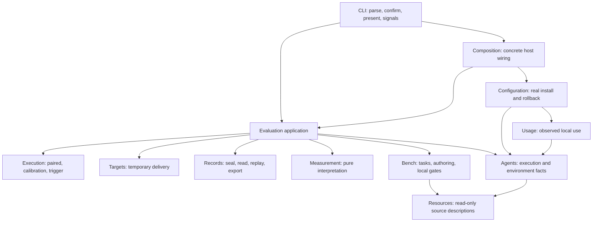
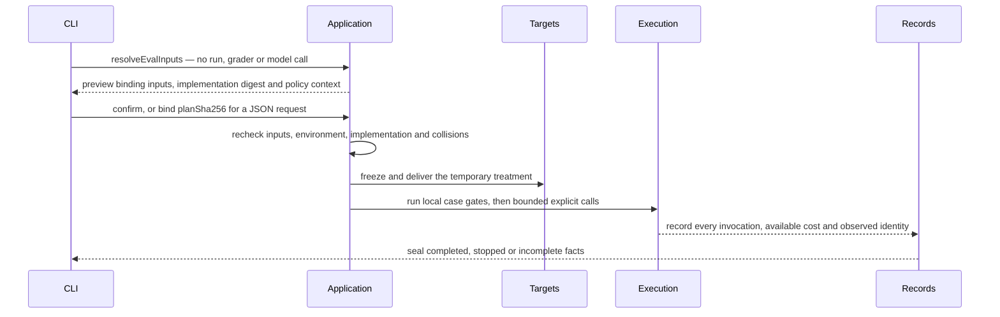

# skillfit architecture

skillfit is one TypeScript/Node >=22 ESM CLI with zero runtime dependencies.
This page explains the current system, the boundaries between its modules and the
contracts a change must preserve. It is not a runbook: commands and contributor
setup live in [AGENTS.md](https://github.com/remote-controlled-man/skillfit/blob/main/AGENTS.md)
and [CONTRIBUTING.md](https://github.com/remote-controlled-man/skillfit/blob/main/CONTRIBUTING.md),
execution order and progress live only in the source-only `docs/work/current.md`,
statistical meaning lives in [metrics](../reference/metrics.md), and publication
gates live in [the release procedure](releases.md).
[Build/version availability](../README.md#choose-your-build) is separate.

## System at a glance



Arrows show selected caller relationships, not every allowed import. Shared
mechanisms sit below business modules. Agent environment facts and health
collection belong to Agents; doctor formats the report and Records fingerprints
declared files. Trigger text is rendered in CLI, so presentation never loads the
experiment scheduler.

## Modules and dependency roles

| Module | Responsibility and allowed business dependencies |
| --- | --- |
| Resources | Read/validate/fingerprint Skill, rules and MCP bytes. Shared only; no install, model call or verdict. |
| Agents | Matrix, capabilities, executors, invocation accounting, vendor decoding and environment interpretation. Shared and Resource contracts; no experiment policy or real-config transaction. |
| Usage | Aggregate normalized Agent observations and Resource inventories. No Configuration/Evaluation dependency. |
| Bench | Load/author tasks and run local gates. Resources/shared and an injected Agent executor for authorized drafting; no Evaluation dependency. |
| Evaluation | Use Bench, Resources and Agents; own Application, Targets, Execution, Measurement and Records. No Configuration writer. |
| Configuration | Selection/planning and real user installation/rollback, using Resources, Agents and Usage. No Evaluation dependency. |
| CLI / Composition | CLI owns parsing, confirmation, presentation, OS signals and exit behavior. Composition connects operations to concrete host adapters. Business modules never import either. |
| Shared | Explicit-input process/path/hash mechanisms. No business imports, discovery, UI, exit or policy text. |

Within Evaluation, Application coordinates Execution, Targets, Records and
Measurement. Calibration and control self-test belong to Evaluation even when the
CLI command starts with `bench`.

[Architecture policy](https://github.com/remote-controlled-man/skillfit/blob/ed5eaff7d222de1c73874ce022785fbe89291017/tools/verify/architecture-policy.json)
registers each active file once by business owner and one of ten technical roles:
contracts, calculation, mechanisms, integration, evidence, execution, application,
entry, configuration or installation. Runtime and type dependencies are checked
separately; unknown or overlapping owners, private imports, unresolved targets,
runtime cycles and stale exceptions fail, and there are currently no role
exceptions. Compiled tests are scanned by the same private-import rule: a test may
reach into the module it belongs to, but crosses every other module only through
that module's declared caller interface. The bounded AST check rejects direct I/O
and implicit environment/clock/random reads in pure roles, UI/exit in Application,
host policy in Shared, Resource writes and vendor `wireShape` access outside Agents.
It follows immutable aliases, destructuring, imported aliases and lexical
shadowing — not arbitrary callbacks, reflection, mutable aliases or general
interprocedural effects. A passing gate proves these rules, not that every
responsibility has the right owner.

## Invariants

- Evaluation never calls the real Configuration writer; temporary Target delivery has a different write policy.
- Business modules never import CLI or Composition; CLI owns OS signal listeners, exit behavior and prompts.
- Shared takes explicit inputs only: no discovery, UI, exit or policy text.
- Measurement is pure; Records owns saved codecs, sealing, audit and readers, and is not a second scheduler.
- Agent-specific paths and behaviors come from `src/matrix/agents.json`, never command-local constants.
- Real configuration writers plan, support dry runs, confirm or accept `--yes`, back up, verify and roll back.
- Fresh run/bundle/bench outputs reject collisions instead of overwriting; evaluation fixtures are disposable copies.
- Unknown stays unknown. A missing observation never becomes zero, final or a free invocation.
- Report, statistical verdict and adoption are three distinct outcomes; synthetic runs never authorize adoption.
- Published bytes remain immutable at fixed Git commits; corrections link the original observation.
- Saved formats verify original bytes before decoding; an unknown version fails clearly rather than being inferred.
- New formats ship readers first; old archives keep their original readers and runtimes.
- Never clean ignored workspaces wholesale — `workspace4skills/` is a private lab.
- Registrations belong to owners and are wired once, not found by runtime scanning.
- No universal runner, store, global type bag or context/container.

## Evaluation lifecycle



A changed implementation requires a fresh reviewed plan. JSON requests bind the
digest; ordinary text CLI keeps its existing confirmation contract. Case gates run
before a paid call or fresh session. Calibration keeps an independent baseline plan
and `planSha256`; trigger keeps single-arm interpretation. Run and authoring hosts
own stop, cost-retention and sealing policy, while Shared processes receive
cancellation/deadline inputs and preserve argv/cwd/env, output bounds, errors and
descendant cleanup. The narrow asynchronous signal scope is not a global business
context, and a sealed stopped result survives host interruption.

`resolveEvalInputs` and `buildEvalPlan` live in `src/evaluation/application/planning.ts`,
`executeEvalPlan` in `application/evaluation.ts` and `readEvaluation` in
`records/read.ts`. They are internal interfaces: a new caller uses the same explicit
public operation and never parses CLI stdout or invokes a dry-run branch to plan.

## Source and document structure

```text
src/
  cli/ + composition.ts   host entry, presentation and concrete wiring
  resources/              read-only descriptions, inventories and fingerprints
  agents/                 capabilities, execution and environment/observation facts
  usage/                  local observation aggregation
  bench/                  tasks, authoring, claims, controls and gates
  configuration/          profiles, upstream, install/setup/bundle and transaction
  evaluation/
    application/          prepare/execute/read/export/self-test use cases
    targets/              freeze/deliver/verify temporary treatments
    execution/            experiment scheduling and stop rules
    measurement/          pure statistics, costs and acceptance interpretation
    records/              sealing, codecs, audit and portable/legacy replay
  shared/                 explicit-input mechanisms
  commands/ + harness/    retained recipe/replay delegates and six test entries

tools/{verify,release}/
docs/{guides,reference,maintainers,work,schemas,examples,assets}/
benches/                  reusable task inputs and provenance
profiles/                 installation inputs
skills/                   shipped CLI driver
dist/                     ignored compiled CLI output
```

Each topic has one canonical page and `docs/work/current.md` is the only plan; the
[docs index](../README.md) routes readers and owns build/version availability.
Bench format and claims stay with [benches](../../benches/README.md). CLI owns help
and parser declarations in `src/cli/definition.ts`, and `tools/verify/cli-reference.mjs`
derives selected reference rows so local tests reject drift. Do not reproduce every
subfolder in every module or collect business types in Shared. Builds compile into an
owned temporary directory before replacing `dist`, removing stale modules while
preserving the last successful build on compilation failure; distribution roots come
from one package-layout helper with explicit caller overrides.

One-off validation and package scratch uses OS temporary directories, release
receipts use explicit external destinations, and retained experiment data belongs to
its own project/study workspace outside this checkout. The default `./runs` resolves
from the caller's working directory; `--runs-root` chooses another parent. See
[workspace ownership](../guides/experiment-workflow.md#store-process-data-and-analysis).

## Bench authoring

`prepareBenchChange` plans init/add/edit/remove with source and target fingerprints,
without UI, verifier or model calls. `draftBenchChange` is separately authorized and
bounded, retaining costs, identity and failures. `applyBenchChange` rechecks inputs,
validates, backs up and rolls back. Public previews cannot mutate private write
bytes; a rejected post-draft apply still finalizes its summary; partial starter writes
remove only owned files; edit and remove preserve unregistered task files.

`src/bench/templates.ts` owns starter content and the shared task-path convention.
New and contributed tasks keep prompt, fixture and private reference under
`tasks/<id>/`, real shared graders remain once at dataset level, and `bench.json` is
the executable index — loading, gates, saved records and replay consume its paths
rather than a directory name. Legacy bundled teaching layouts stay readable.
Reorganizing changes the current Bench hash while saved observations keep their
original sealed identities.

## Write and evidence contracts

Real configuration writers follow the invariant above; explicit upstream fetch during
Configuration selection/preview is preserved. Repository edits use Git review and
checks rather than the installer's backup and confirmation flow. Current source keeps
no repository archive catalog or restorer and no mandatory historical-study release
stage, but preserves current saved-result readers and portable replay with their
original runtime requirements.

## Domain terms and owners

| Term | Meaning / owner |
| --- | --- |
| Resource | Skill/rules/MCP source bytes and metadata; Resources. Injectable-text and full-resource hashes differ. |
| Target | Resource treatment/baseline; Evaluation Targets freezes and delivers it temporarily. Real installation belongs to Configuration. |
| Bench | Tasks, fixtures, verifiers, oracles, claims and controls; Bench, without Run orchestration. |
| Run | Reviewed attempted execution and completed/stopped/incomplete facts; Execution schedules, Records retains and seals. |
| Usage | Local invocation/coverage observations; Usage. Activation alone does not prove efficacy. |
| Report | A projection of saved Run/Usage facts, not a new observation. Verdict and usage summary remain distinct. |
| Evidence | Explicitly published scoped results with identified Runs, payload/runtime hashes, replay requirements and limitations. A Run is not automatically Evidence. |
| Release | Software delivery and source/installation proofs, separate from efficacy Evidence. |

## Extension contracts and effects

Experiment design, Resource kind, delivery, claim and synthetic control are
independent axes. Validate supported combinations before dispatch; do not make one
mode enum govern every axis, and do not change legacy public mode strings, JSON
order, defaults or entry-specific confirmation to simplify an implementation. Agent
adapters own wire/session/identity decoding. Declared capability, locally checked
availability and actual call coverage differ, and missing usage still stops under a
strict budget; both primary and judge requirements enter preflight. New observations
retain hashes and final/partial/unknown scope, and configured identity never
substitutes for served identity.

| Operation | Effects |
| --- | --- |
| Evaluation prepare | Read and return a fingerprinted plan; no grader/model dispatch or run creation. |
| Evaluation execute | Recheck confirmed inputs, run local gates, make bounded explicit calls, seal terminal/partial facts. |
| Records read/replay/export | Verify bytes before reading; explicit replay runs trusted pinned/local graders, never Agents. Export previews and writes a fresh external destination. |
| Bench load/gate/draft/apply | Load does not grade; gates run tools; drafting is separately authorized; apply rechecks and preserves rollback. |
| Configuration prepare/apply | Selection may explicitly fetch upstream; no target write before confirmation; apply backs up, verifies and rolls back. |

Preview, failure, cancellation and repeated apply are interface contracts.

## Format, identity and replay compatibility

Records owns kind/version dispatch through `src/evaluation/records/formats.ts`,
including the explicit legacy summary adapter and replay runtime requirements;
readers, exporter, portable validation and the serialized launcher share it, and
paired and single-arm audits remain independent. Current saved versions are plan,
session, artifacts and portable package at 1, with paired summaries at 4 and
calibration/trigger summaries at 1. Legacy filename/field inference stays in legacy
adapters, and missing legacy claims/usage/identity stay unrecorded rather than
being filled from today's metadata.

Resource hash, plan digest, implementation digest, format version, statistical
protocol and npm version identify different things. Fingerprint all relevant
runtime; a moved module must not drop out of the fingerprint to retain an old
approval. Pure rendering may change presentation, never observations or recorded
interpretation, and an alternative assessment identifies its own policy and
implementation.

Installed recipes and generated replay launchers depend on paths such as
`harness/interruption.js`. Keep their exact-contract delegates and the same error
class identity rather than duplicate implementations: they are compatibility
interfaces, not extension points, and removal needs an explicit reader/format
migration. New Session details use a Records-owned typed writer contract, and
behavior-driving flags and implementation identities are validated before
writes/probes. The current writer must not use an untyped metadata dictionary as a
control channel. Test built, installed and relocated packages, not only source imports.

## Artifact lifecycle

| Artifact | Owner and retention |
| --- | --- |
| Source/tests/Bench inputs/schemas | Canonical owning tree; retain reusable inputs and actual regression consumers. |
| Native Run facts and sealed inputs/runtime | Records; immutable batch directory, including failed/stopped observations. |
| Derived analyses, reports and temporary work | Explicit siblings outside sealed batches; retain methods/results only while consumed. |
| Shared evaluation | Complete verified export for an actual recipient/claim; state interpretation and availability limits. |
| Release proofs | One external proof bundle per attempt; source keeps changelog/current links, never imports receipts. |
| Current work | One ordered plan; replace status/results and link prior details instead of appending transcripts. |

The [experiment workflow](../guides/experiment-workflow.md#store-process-data-and-analysis)
owns the outer workspace, the observed/derived process-data rules and the manual
retention/cleanup procedure. Two boundaries stay here because they are module
ownership rather than procedure: a sealed transcript or trial workspace is not
scratch, and a failed Run stays in its explicit workspace without creating a new
source page, catalog or mandatory release check.

## Growth controls

Existing checks enforce purpose/ownership, one plan, no executable recipes in docs,
no generated trees in source or npm, and explicit writer destinations. Version and
Skill checks require no per-version page. Registering a file does not justify it: a
new page needs a recurring task or contract and an owner. Verify actual package
contents and dependency closure. No universal file or line-count gate is imposed.

| Change | Expected locality and acceptance |
| --- | --- |
| Agent with existing contracts | Matrix/adapter and contract fixtures; no vendor branches in planner/Usage. Unsupported capabilities refuse before calls. |
| Resource variant | Resources and temporary Target delivery tests; no measurement or real-config transaction change. A new public kind needs schema/capability work. |
| Report or metric | Display in presentation; metric in Measurement when the facts exist. New facts or meaning need protocol/read support. |
| Experiment design | Execution, Application wiring and declared measurement/read support; no forced paired/single-arm unification. |
| Historical reader/transport | Records/legacy with consumed compatibility fixtures; no old-byte rewrite or live execution. |

These are acceptance scenarios, not a plugin system. Test normal, unsupported,
missing-counter, failure/abort and historical cases through caller interfaces, and
retain installed/CLI/replay checks. Depth means behavior behind a small interface;
locality and leverage, not more directories, justify a seam.

## Key decisions

| Decision | Why | Cost |
| --- | --- | --- |
| Modular CLI with explicit contracts | One business owner and a small interface per module closes the ownership and writer-admission gaps a pruned flat source leaves open | Import, effect and package checks must stay green |
| Not multiple packages or an artifact platform | No independent consumers, release owners or measured volume justify the operations, authentication and versioning overhead | Revisit when real independent ownership appears |
| Zero runtime dependencies | The shipped CLI stays self-contained and auditable | Reimplement mechanisms Node already provides |
| Generated attempts, reports, receipts and frozen run copies stay external to source and npm | Source stays reviewable and published bytes stay immutable | No archive catalog or restorer; old studies live only at fixed commits |
| One page per topic and one plan | Readers and agents find the owner instead of reconciling copies | A fact must be linked, never restated |
| Formats and identity owned independently of paths and versions | A moved module or renamed file must not invalidate an approval or a sealed record | Version dispatch has to stay explicit |
| Checks enforce imports, effects, admission and destinations — not file counts | A count gate punishes depth, which is the point of a seam | Responsibility ownership still needs human review |
| Tests cross other modules only through their declared interface | A test importing another module's private file pins its internals as firmly as a production import, and this rule did not cover tests at all | Crossings that predate the rule are recorded as debt rows, and a row that stops matching a live violation fails the build, so the ledger can only shrink |
| The agent matrix is validated against its own published schema | `loadMatrix()` is a type assertion, so a stale or misspelled field satisfied every gate while the schema shipped to npm users and outside matrix corrections were solicited | The validator implements only the keywords the schema uses and refuses any other, so a new keyword needs a validator change before it can be used |
| Restatement is caught by diffing the corpus against itself, not by a hand-kept list | A registry of owned facts only covers what someone remembered to enter, which is why the 2,124-line policy file was retired; the duplicate detector derives from the tree and needs no upkeep | Verbatim matches only, so a paraphrased copy still depends on review |
| No maintained page states which version the registry currently serves | Four pages each restated it and all four drifted the day 0.14.0 shipped. Gating version tokens instead would need allowances for the six non-current versions the release documents legitimately carry as feature minimums and superseded-release pointers, rebuilding the retired registry | Write version-neutral wording and let the registry answer; the pinned `skillfit@<version>` commands remain gated against `package.json` |

The original [dependency](https://github.com/remote-controlled-man/skillfit/blob/3a3ff415ccef1a3a45d1e2d2cc00d903ab7db850/docs/decisions/0002-layering-and-shared-execution.md),
[confirmation](https://github.com/remote-controlled-man/skillfit/blob/3a3ff415ccef1a3a45d1e2d2cc00d903ab7db850/docs/decisions/0003-plan-confirm-execute-separation.md)
and [documentation](https://github.com/remote-controlled-man/skillfit/blob/3a3ff415ccef1a3a45d1e2d2cc00d903ab7db850/docs/decisions/0001-document-authority-and-history.md)
records remain fixed historical sources.

## Non-goals

New statistical thresholds, paid research, microservices, plugin loading and
destructive workspace cleanup. No extra storage platform or retention job is
planned. A concrete new public format or protocol needs its own compatibility
design, and no current guarantee extends to arbitrary future experiments, public
kinds or distributed execution.
